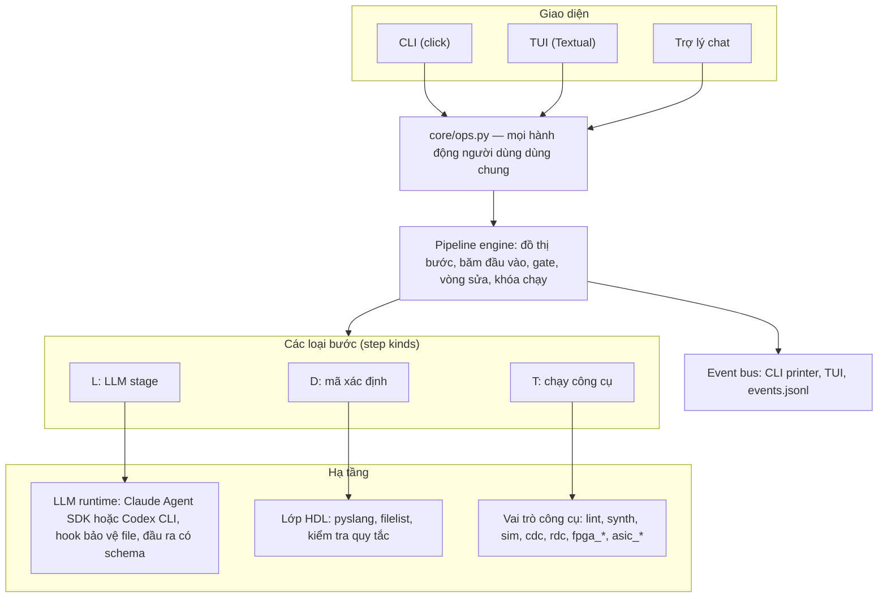
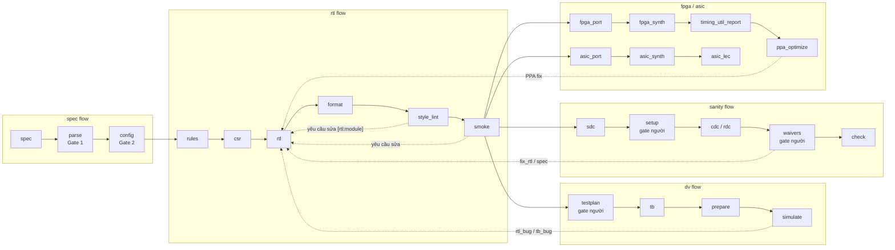
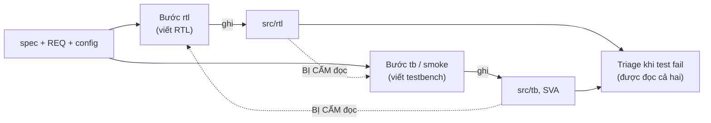

# Q3TUI (VLSIT_Q3TUI_ASIC_AI_FLOW) — Báo cáo phân tích kỹ thuật

| Mục | Giá trị |
|---|---|
| Đối tượng phân tích | Repo `C:\HQuan\102_MyGithub\VLSIT_Q3TUI_ASIC_AI_FLOW`, phiên bản 0.1.0 (Beta), giấy phép Apache-2.0, commit `cbf1ab9` (có 22 file sửa chưa commit và một số file mới chưa theo dõi trong working tree, chủ yếu backend Codex và tài liệu điều phối nhiều model) |
| Ngày phân tích | 2026-11-05 |
| Người đọc chính | Designer RTL/ASIC dùng tool; người bảo trì flow |
| Phương pháp | Đọc toàn bộ tài liệu thiết kế (`docs/spec/*.md`, `docs/user_guide.md`), đọc mã nguồn các phần quyết định chất lượng RTL (engine, runtime LLM, bộ kiểm tra quy tắc RTL, tạo SDC, script Design Compiler / Vivado, flow sanity), đối chiếu quy tắc RTL của tool với `VLSIT_RTL_Design_Rule.md` v2, thử chạy bộ test. **Không chạy LLM thật và không chạy công cụ EDA thương mại** (xem mục 10 về giới hạn) |

Các thuật ngữ viết tắt được giải thích ở lần dùng đầu và ở Phụ lục C.

---

## 0. Tóm tắt điều hành

**Q3TUI là gì.** Một giao diện terminal (TUI, Textual) và dòng lệnh (CLI) điều khiển một **pipeline có cổng duyệt (gate)** để đưa một khối phần cứng từ *ý định hoặc spec* tới *RTL đã kiểm tra*, *testbench*, kết quả *CDC/RDC*, *PPA trên FPGA* và *tổng hợp ASIC có kiểm tra tương đương*. LLM (Claude Agent SDK, hoặc Codex CLI) làm các việc viết và suy luận; **mọi thứ đo được đều do code và công cụ EDA làm**, LLM chỉ nhận kết quả đó như sự thật.

**Điểm mạnh cần giữ** (bằng chứng ở mục 4 và 6):

1. Phân ranh rõ giữa phần *xác định* (parse bằng pyslang, kiểm tra quy tắc, lint, tổng hợp, đọc log) và phần *LLM*. Một công cụ không có thì bước đó **N/A và không bao giờ được tính là pass**.
2. *Độc lập kiểm chứng được cưỡng chế bằng hook*: RTL không thấy testbench, testbench không thấy RTL (`deny_dirs` qua hook `PreToolUse`), không chỉ dặn trong prompt.
3. *Cập nhật thay vì chạy lại*: mỗi bước băm đầu vào (SHA-256), chỉ sửa phần bị ảnh hưởng, giữ nguyên phê duyệt của người.
4. *Vòng sửa lỗi có kỷ luật*: lỗi được phân loại (lỗi RTL, lỗi testbench, lỗi spec) rồi trả về **bước sở hữu**, có giới hạn số vòng, vòng lặp lặp lại thì chuyển thành câu hỏi cho người.
5. Có sẵn các cơ chế hiếm gặp ở tool tương tự: kiểm tra "kết quả có phải là thiết kế thật không" cho PPA FPGA, quy trình waiver CDC/RDC có bộ nhớ và giới hạn thử lại, vá (patch) cho RTL do generator sinh ra.

**Các phát hiện quan trọng nhất cho chất lượng RTL** (chi tiết và phản biện ở mục 8):

| # | Phát hiện | Mức |
|---|---|---|
| 1 | Bộ quy tắc RTL đi kèm là **bản cũ** của `VLSIT_RTL_Design_Rule.md` v2: lệch 92 dòng (thiếu SCP-03, NAM-09 `u_dont_touch_`, TYP-06, văn bản PAR-04 khác, vẫn khuyến nghị `default_nettype none` trong khi v2 cấm directive này). RTL do Q3TUI sinh có thể không qua checker v2 của bạn | Cao |
| 2 | Preset công cụ cho flow `rtl` chỉ có Verible (kiểu code) và bộ sinh CSR. **Lint ngữ nghĩa, tổng hợp và mô phỏng không có mặc định mã nguồn mở**; người dùng phải tự khai báo. Verible chỉ bắt lỗi cú pháp và kiểu code, không bắt latch, độ rộng, vòng tổ hợp, CDC | Cao |
| 3 | "Độ phủ" trong flow `dv` là **độ phủ truy vết** (mỗi REQ có test case), **không** phải độ phủ code hay chức năng. Không có SVA, không có formal, không có mutation (đã bị gỡ). Ví dụ `axi4_sram_ctrl` ghi rõ: functional coverage và assertions còn `todo`, TC-007 `INCOMPLETE`, ba quy tắc scoreboard không được kiểm tra | Cao |
| 4 | SDC sinh một lần từ tài liệu spec với mặc định tùy ý: **clock uncertainty = 0**, độ trễ I/O đều 30% chu kỳ, chu kỳ mặc định 10 ns nếu spec không nói. Cùng một SDC được dùng cho FPGA, ASIC và CDC | Cao |
| 5 | Tổng hợp ASIC chỉ ở mức "tiền layout": một corner, không scan/DFT, không clock gating, không hold-fix, công suất không có hoạt động chuyển mạch. Chuỗi `q3tui auto` mặc định **không gồm flow `asic`** | Trung bình đến Cao |
| 6 | Chế độ không giám sát (`auto_answer`, `--yes`) trả lời **mọi câu hỏi spec bằng giá trị mặc định**; các quyết định này ảnh hưởng RTL nhưng không có sổ quyết định buộc người ký | Cao |
| 7 | Không có cơ chế **dùng lại thư viện IP đã duyệt** (đồng bộ hóa, FIFO bất đồng bộ, reset synchronizer): LLM viết lại các khối CDC cho từng dự án, trong khi quy tắc CLK-01/02 yêu cầu cấu trúc "đã được dự án duyệt" | Cao |
| 8 | Hồi quy của repo là 740 hàm test **không dùng LLM và không dùng EDA thật**; không có bộ benchmark đo *chất lượng RTL đầu ra* (pass-rate lint/smoke/dv/CDC/PPA trên các IP chuẩn) | Cao |

**Khuyến nghị tổng quát** (mục 9): ưu tiên P0 gồm đồng bộ quy tắc RTL một nguồn, cấu hình lint/tổng hợp/mô phỏng mã nguồn mở mặc định, thêm đo độ phủ thật và SVA/formal vào `dv`, làm SDC "fail-closed" khi spec im lặng, đưa `asic` vào chuỗi `auto`, và dựng benchmark chất lượng RTL.

---

## 1. Định vị và phạm vi

```text
spec ──► rtl ──► dv ──► sanity ──► fpga / asic
 (ý định)  (RTL)  (testbench) (CDC/RDC)  (PPA / tổng hợp)
```

| Câu hỏi | Trả lời |
|---|---|
| Làm gì | Tạo và kiểm tra **khối IP mới** (vài miền clock) từ ý định hoặc spec; không nâng cấp RTL có sẵn, chỉ nhập (import) để kiểm tra và chuẩn hóa |
| Ai dùng | Designer RTL/DV, người làm tổng hợp; một người điều khiển, LLM làm việc, người quyết định ở các cổng |
| Không làm gì | Formal, đặt-và-đi dây (P&R) ASIC, DFT/scan, UPF/công suất tĩnh, GCA (đã nêu "chưa xây"), tài liệu spec cuối cùng, web UI |
| Nguồn gốc | Hợp nhất từ `VLSIT_RTL_Generator_AI_Model` (flow `/autoflow`), nhánh `tb_env_dev_taidao` (UVM, ví dụ `axi4_sram_ctrl`) |
| Quy mô mã | khoảng 54.000 dòng Python (cả test), 285 file trong gói `q3tui/`, 73 file test (740 hàm test), 23 tài liệu thiết kế, 60 file ví dụ |
| Phụ thuộc chính | Python ≥ 3.12, `claude-agent-sdk`, `pyslang`, `textual`, `click`, `pydantic`, `jsonschema`, `openpyxl`, `pyyaml` |

---

## 2. Bản đồ cấu trúc repo (cái gì nằm ở đâu)

```text
VLSIT_Q3TUI_ASIC_AI_FLOW/
├── README.md, CLAUDE.md         Giới thiệu; CLAUDE.md = quy ước mã và bố cục cho người bảo trì
├── install.sh, pyproject.toml   Cài đặt một dòng (uv); lệnh q3tui = q3tui.core.cli:run_cli
├── q3tui.example.yaml           Mẫu cấu hình (model, mô-đun tool)
├── docs/
│   ├── user_guide.md            Hướng dẫn người dùng (14 mục)
│   └── spec/                    Tài liệu THIẾT KẾ: một file cho mỗi flow + engine + cấu hình
├── examples/                    apb_slave (chỉ ý định), axi4_sram_ctrl (dv/UVM kèm kết quả), apb_dual_clk*
├── tests/                       73 file test, không cần LLM hay EDA
└── q3tui/                       GÓI CHÍNH
    ├── core/                    cli, config, settings, project, ops (mọi hành động người dùng), events,
    │                            chain (auto), loop (vòng sửa CDC), lanes (chạy song song), history, importer
    ├── pipeline/                engine.py (1.487 dòng: đồ thị bước, băm, gate), base.py (StepDef), state.py
    ├── llm/                     runtime.py (run_stage, hook bảo vệ file), roles/team, assistant, codex/ (backend 2)
    ├── eda/                     tools.py (vai trò công cụ), slang, synopsys, vcd, presets/ (JSON mẫu theo flow)
    ├── hdl/                     filelist + parse bằng pyslang
    ├── steps/                   common (câu hỏi, câu trả lời, yêu cầu thay đổi theo phạm vi)
    ├── flows/                   MỖI FLOW LÀ MỘT THƯ MỤC DỮ LIỆU + MÃ
    │   ├── spec/    (23 file)   spec → parse → config
    │   ├── rtl/     (44)        rules → csr → rtl → format → style_lint → smoke   (+ rules/, skills/)
    │   ├── dv/      (47)        testplan → tb → prepare → simulate   (plain/ và uvm/)
    │   ├── sanity/  (33)        sdc → setup → cdc/rdc → waivers → check
    │   ├── fpga/    (27)        fpga_port → sdc → fpga_synth → timing_util_report → ppa_optimize
    │   ├── asic/    (22)        asic_port → sdc → asic_synth → asic_lec
    │   └── project/, example/   Cài đặt dự án; flow mẫu tối thiểu
    └── tui/                     Giao diện Textual (panel theo loại bước)
```

**Thư mục của MỘT dự án thiết kế** (do `q3tui init` tạo, mọi flow dùng chung):

| Đường dẫn | Nội dung | Ai sở hữu |
|---|---|---|
| `spec/` | `intent.md` hoặc spec của bạn; `ref/` tài liệu nhập | Bạn |
| `config/` | `tools.json` (vai trò công cụ), `rtl_rules.md` (quy tắc của bạn), `pdks.json`, `skills/` | Bạn |
| `src/rtl/` | RTL, `filelist.f`, module CSR sinh tự động, `style_lint/`, `smoke/` | Flow `rtl` |
| `src/tb/` | Testbench của flow `dv` | Flow `dv` |
| `constraints/sdc/` | `sdc.json` (nguồn) và các `.tcl` sinh ra | Chung FPGA/ASIC/sanity |
| `schemas/` | Kết quả JSON của từng bước (`structured_spec.json`, `final_config.json`, `ppa_report.json`, …) và `questions/` | Q3TUI |
| `reports/`, `reviews/` | Báo cáo hiển thị; quyết định duyệt của bạn (giữ khi reset) | Q3TUI / Bạn |
| `build/` | Đầu ra công cụ, dùng một lần | Q3TUI |
| `.q3tui/` | Trạng thái nội bộ: `pipeline.json`, lịch sử, cache, log, khóa chạy | Q3TUI (LLM bị cấm đọc) |

---

## 3. Kiến trúc

### 3.1 Các lớp



Ba điểm kiến trúc đáng nhớ:

- **Một engine, ba mặt tiền**. CLI, TUI và trợ lý chat đều gọi `core/ops.py`; thêm hành động mới phải mở ở cả hai nơi (quy ước trong `CLAUDE.md`).
- **Flow là dữ liệu**. Một flow là file/thư mục liệt kê *loại bước*, phụ thuộc, chế độ gate, tùy chọn (`flows/__init__.py`, `docs/spec/flows.md`). Engine không hard-code tên bước.
- **Công cụ EDA qua "vai trò"**. Bước gọi `run_role(tools, "lint", …)`, không bao giờ gọi binary. File `config/tools.json` ánh xạ vai trò → câu lệnh mẫu + bộ đọc log; bộ đọc chuẩn hóa chẩn đoán thành `{severity, code, file, line, message}`.

### 3.2 Chuỗi flow và ai bàn giao cho ai



Quy ước then chốt: **mọi flow kiểm tra chỉ đọc RTL**; khi cần sửa, nó gửi *yêu cầu thay đổi theo phạm vi* `[rtl:<module>] …` tới bước `rtl` của flow sở hữu RTL. Flow đó cập nhật đúng module đó, rồi các flow kiểm tra chạy lại phần cũ (stale). `q3tui auto` chạy chuỗi `pipeline.chain` (mặc định `spec, rtl, dv, sanity, fpga`) cho tới khi mọi flow đã qua với **cùng một bản RTL cuối**, tối đa `chain_max_runs` (mặc định 3) lượt.

### 3.3 Chế độ cổng (gate)

| Chế độ | Hành vi |
|---|---|
| `human` | Luôn dừng; chỉ bạn duyệt |
| `auto` | Tự duyệt khi không còn câu hỏi *chặn*; mục "cần xem lại" chưa xác nhận không chặn |
| `auto_answer` | Chạy không giám sát: duyệt, và **trả lời mọi câu hỏi bằng giá trị mặc định** |
| `none` | Không có cổng |

Cổng mặc định: `spec` (người), `parse` (Gate 1, người), `config` (Gate 2, tự động theo mặc định), `testplan` (người), `setup`/`*_waivers` của sanity (người), `asic_port`/`asic_synth`/`asic_lec` (người), `timing_util_report` và `ppa_optimize` (người).

### 3.4 Độc lập kiểm chứng (ai được thấy gì)



Cưỡng chế: hook `PreToolUse` của Agent SDK trong `q3tui/llm/runtime.py` (`check_tool_paths`, `guard_reason`) chặn mọi công cụ file nằm ngoài `cwd + add_dirs` hoặc trong `deny_dirs`; `.q3tui/` luôn bị cấm và `Glob` gốc được thay bằng `mcp__q3tui__glob` (`safe_glob`) để không lộ file bị cấm. Phía dv UVM, RTL chỉ được đọc ở pha tích hợp cuối, sau khi hợp đồng kiểm chứng đã đóng băng (quy tắc DUT-DV-026).

### 3.5 Cách engine biết bước nào cần chạy lại

`pipeline/engine.py::inputs_hash` băm: nội dung từng file đầu vào, danh sách file vắng, các yêu cầu thay đổi đang chờ, các tùy chọn có băm, `checks_version` (khi bộ kiểm tra của Q3TUI đổi thì kết quả cũ phải kiểm lại, không gọi LLM nếu vẫn đạt) và dấu vân tay của file flow. `evaluate()` so với băm lưu trong `pipeline.json` để cho ra trạng thái `done / stale / pending / failed / user / missing_input / running`. Một bước đang chạy giữ khóa `.q3tui/run.<flow>.lock`; nhiều flow chạy cùng thư mục được hợp nhất trạng thái theo từng bước (`merge_states`).

Hệ quả thiết kế: **không có "chạy lại toàn bộ" ngầm**. Thay một REQ, chỉ phần liên quan đổi; file bạn sửa tay được nhận ra (băm khác bản đã ghi) và `format` hỏi trước khi chạm.

### 3.6 Lớp LLM

| Khía cạnh | Thực tế trong mã |
|---|---|
| Hợp đồng một stage | `Stage(...)`: danh sách công cụ cho phép tường minh, `permission_mode="dontAsk"`, mô hình pydantic cho đầu ra |
| Đầu ra có cấu trúc | SDK không cưỡng chế chặt; `run_stage` tự kiểm bằng pydantic và hỏi lại trong cùng phiên |
| Công cụ nội bộ | MCP trong tiến trình `mcp__q3tui__*` (sự kiện thiết kế, glob an toàn, `verible_lint`, `smoke_compile`, `smoke_run`, `csr_check`, …) |
| Phiên | `fresh` (mỗi stage một phiên) hoặc `flow`; chế độ team có phiên bền theo vai trò (architect, modeler, designer, verifier); reviewer luôn `fresh` |
| Ngân sách | `llm.max_budget_usd`, `llm.stage_token_budget`; ghi chi phí mỗi lần chạy; cache đáp án từng stage để chạy tiếp khi bị ngắt |
| Backend | Claude Agent SDK (mặc định, model `claude-sonnet-5-5`) hoặc Codex CLI (`llm.backend: codex`, có hạn chế: chưa áp dụng model theo bước) |


---

## 4. Từng flow: vai trò, bước, đầu vào/ra, công cụ

### 4.1 Flow `spec` — từ ý định tới yêu cầu và cấu hình đã khóa

| Bước | Loại | Làm gì | Ghi ra | Cổng |
|---|---|---|---|---|
| `spec` | LLM | Viết `spec/spec.md` theo **mẫu VLSIT 21 mục** (Purpose, Requirements `REQ-<AREA>-<NNN>`, Features `FEAT-NNN`, Parameters `PARA_*`/`LPARA_*`, Interfaces, CSR pointer, RTL contract, Verification, Traceability, Assumptions …) từng mục; hỏi những gì ý định để ngỏ. Nếu bạn đưa spec sẵn thì bước này coi như xong | `spec/spec.md`, `schemas/questions/spec.*` | Người |
| `parse` | LLM + pyslang | Trích **yêu cầu đánh số `REQ-NNN`**, tham số, **bản đồ module**; đánh dấu yêu cầu mơ hồ thành câu hỏi | `schemas/structured_spec.json` | Gate 1 (người) |
| `config` | LLM + mã | Khóa giá trị tham số, ràng buộc kiểm bằng code | `schemas/final_config.json` | Gate 2 (tự động) |

Điểm kỹ thuật: câu hỏi mang **loại** (`spec_gap`, `req_gap`, `arch_gap`, `design_choice`) quyết định bước nào sở hữu câu trả lời; bước sau *không bao giờ tự lách* vấn đề của bước trước mà trả nó về. Câu trả lời đã chốt được truyền xuống như *quyết định đã giải quyết* (`settled_questions`) để không hỏi lại.

### 4.2 Flow `rtl` — viết RTL và kiểm tra

```text
spec ─► rules ─► parse ─► config ─► csr ─► rtl ─► format ─► style_lint ─► smoke
```

| Bước | Loại | Làm gì | Công cụ (vai trò) |
|---|---|---|---|
| `rules` | LLM + mã | Đọc *chồng quy tắc* (`config/rtl_rules.md` của bạn đứng trước, rồi `rtl_rule_default.md`), **kiểm mâu thuẫn trước khi viết RTL**, sinh cờ Verible (`verible.flags`, `format.flags`) | `verible_lint` (để thử cờ) |
| `csr` | LLM + mã | Chỉ chạy khi spec nói có thanh ghi: LLM soạn bản đồ thanh ghi, mã kiểm (offset trùng/lệch, trường chồng, reset quá rộng, chỉ dữ liệu 32-bit), chạy **APB-CSR-Generator** sinh module, cài vào `src/rtl/` và khai báo "provided" | `csr_gen` |
| `rtl` | LLM + mã + công cụ | **Một stage LLM cho mỗi module**, thứ tự biên dịch lá trước top sau. Sau mỗi module: kiểm quy tắc bằng code (`rules_check.py`), thẻ `// REQ-xxx`, lint (0 cảnh báo mặc định), tổng hợp (DC hoặc Yosys). Phần còn lỗi đi tới một phiên nhỏ mới chỉ với lỗi + file hiện tại. Cập nhật: chỉ module có snapshot đổi mới được viết lại | `lint`, `synth` (do bạn khai báo) |
| `format` | Mã | `verible-verilog-format`, chỉ chấp nhận nếu chỉ khác khoảng trắng; **hỏi trước khi chạm file bạn sửa tay** | `verible_format` |
| `style_lint` | Mã + LLM | Verible lint; không có phát hiện → không gọi LLM. Có: một thẩm phán LLM phân loại *sửa / sai cờ / miễn (waive, kèm quy tắc cho phép) / hỏi*. Mã phân phát: sửa → `rtl` theo `[rtl:module]`, sai cờ → `rules` | `verible_lint` |
| `smoke` | LLM + mã | Testbench cơ bản **chỉ viết từ spec** (3–6 hành vi), tự biên dịch/chạy qua công cụ; **mã quyết định kết quả** (`SMOKE_RESULT <id> PASS/FAIL`). Fail → LLM triage thứ hai (`rtl_bug` / `tb_bug` / `spec_issue` / `unsure`); một smoke fail không bao giờ "xong" | `sim`, `run` |

Vòng sửa: `rtl → format → style_lint → (sửa → rtl)`, rồi `smoke`, tối đa `options.max_rounds` (mặc định `pipeline.max_fix_iterations` = 5). Hết vòng thì bước **fail**, không để dư lỗi.

**Cơ chế đáng chú ý trong module CSR sinh tự động**: nó được coi là *provided*, không viết bằng LLM; lint của nó được sửa tại chỗ; mọi sửa đổi được ghi thành **patch** (`src/rtl/csr/patches/<module>.patch`) và được áp lại khi generator sinh lại (có fuzz như GNU patch); hunk không khớp quay về bước `rtl` thành yêu cầu thay đổi.

### 4.3 Flow `dv` — testbench độc lập và mô phỏng

```text
spec ─► parse ─► config ─► testplan ─► tb ─► prepare ─► simulate
```

Hai loại testbench (tùy chọn `testbench` của bước `tb`: `plain` | `uvm` | `auto`):

| | `plain` (mọi IP) | `uvm` (cần VIP giao thức có sẵn) |
|---|---|---|
| `testplan` | Kế hoạch test: mỗi test case ghi các REQ nó kiểm; REQ không test nào phủ → câu hỏi chặn; REQ mà mô phỏng không kiểm được (tần số, lint, SDC) được **loại có lý do** | **Hợp đồng kiểm chứng**: test, mục tiêu, luật scoreboard, mục tiêu coverage, vấn đề mở, đóng băng bằng băm; chỉ đóng băng khi không còn vấn đề `BLOCKED` |
| `tb` | `tb_top.sv` + 1 file/test case (LLM), biên dịch với RTL | Kiến trúc, gắn VIP, khung sinh bằng mã, LLM điền vùng `DV_REGION`; **sau cùng** mới tích hợp RTL làm DUT: kiểm tuân thủ giao diện (lệch = phát hiện, không bao giờ điều chỉnh kỳ vọng theo RTL) |
| `prepare` | Chỉ `plain`: tạo chương trình/dữ liệu (RISC-V GCC + Spike) mà test nạp | — |
| `simulate` | Mỗi test chạy riêng `+TC=<id>`, đọc `TC_RESULT`; **không có dòng kết quả = FAIL**; test thiếu file đầu vào = `BLOCKED`; quá giờ = `TIMEOUT` | PASS chỉ khi simulator trả 0, không có `UVM_ERROR/FATAL`, dòng kết quả PASS và không còn `DV_TODO`; test chạy sạch nhưng không có check = `INCOMPLETE` |

Khi test fail, **triage** (LLM đọc được cả RTL, theo kỹ năng `sim-triage`) ra phán quyết: `tb_bug` (sửa testbench theo test), `rtl_bug` (đẩy `[rtl:<module>]` sang flow RTL), `prepare_bug`, hoặc `spec_issue/unsure` (hỏi bạn). Có công cụ sóng (`wave`) thì triage dùng bằng chứng thực thay vì chỉ đọc code.

### 4.4 Flow `sanity` — CDC và RDC

```text
sdc ─► setup ─► cdc ─► cdc_waivers ─► cdc_check
          └──► rdc ─► rdc_waivers ─► rdc_check
```

- `setup`: một stage LLM chỉ-đọc quyết định môi trường phân tích (reset: cực tính, đồng bộ/không đồng bộ; black box cho bộ nhớ; tín hiệu quasi-static `create_static`; hằng `set_case_analysis`; bộ đồng bộ reset cho RDC) kèm bằng chứng; **mã kiểm tên và chạy thử công cụ**, đưa lỗi của công cụ về cùng phiên (2 vòng) — phần còn sai bị bỏ chứ không đưa sang phân tích.
- `cdc` / `rdc`: VC Static; **mọi** fatal/error/warning là một vi phạm; đọc từ báo cáo, không từ log.
- `*_waivers`: mỗi vi phạm nhận đúng một quyết định: `waive` (theo luật tri thức K1–K5 hoặc U1… của dự án, mọi điều kiện đã kiểm và trích dẫn), `fix_rtl`, `spec`, `sdc`, `ask`. Có bộ nhớ những gì đã thử (`handoffs.json`); yêu cầu trùng hoặc thử lần ba chuyển thành câu hỏi cho người.
- `*_check`: mã chạy lại công cụ với waiver; **số đếm phải khớp chính xác** (tìm thấy / đã waive / còn mở), nếu không là fail.
- Vòng sửa riêng: `q3tui --flow sanity loop` (phân tích → bàn giao → flow RTL cập nhật → phân tích lại; dừng khi sạch, không cải thiện, hết vòng hoặc hết ngân sách; giữ RTL của vòng tốt nhất).

### 4.5 Flow `fpga` — ước lượng PPA

`fpga_port` (quét mã + người "porter" LLM, tạo ảnh bộ nhớ, đẩy việc sửa RTL sang flow sở hữu) → `sdc` (dùng chung) → `fpga_synth` (Vivado 7-series; Yosys + nextpnr cho ECP5/iCE40; Quartus Prime Pro/Standard — họ linh kiện quyết định công cụ) → `timing_util_report` (LUT/FF/BRAM/DSP, WNS, Fmax, đường tới hạn; **thẩm phán "đây có phải thiết kế không"** khi log cho thấy logic bị loại bỏ; kết quả không hợp lý thì hỏi bạn) → `ppa_optimize` (khi trượt mục tiêu: một stage chỉ-đọc đề xuất ≤ 5 sửa, bàn giao `[rtl:module] PPA …`).

### 4.6 Flow `asic` — tổng hợp ô chuẩn và kiểm tra tương đương

`asic_port` (quét mã tìm primitive FPGA, `$display`, `#delay`, mảng nhớ lớn… + porter LLM đề xuất wrapper SRAM/synchronizer/ICG… dưới dạng lệnh công việc cho RTL) → `sdc` → `asic_synth` (Design Compiler: SVF trước, `compile_ultra`, netlist + `.ddc` + SDC, báo cáo area/timing/qor/power/constraints/check_design/check_timing; **Fmax kỳ vọng** = `1000/(chu kỳ − slack)`) → `asic_lec` (Formality: RTL tham chiếu vs netlist; **không tương đương / không kết luận = fail, không waive**). Thư viện chọn theo "công nghệ rồi corner" từ `pdks.json` (chỉ PDK mã nguồn mở có sẵn: GF180MCU, FreePDK45 OSU).

### 4.7 Cơ chế chạy song song và chạy không giám sát

| Cơ chế | Lệnh | Ý nghĩa |
|---|---|---|
| Chuỗi tự động | `q3tui auto [--flows a,b]` | Chạy `pipeline.chain` tới khi mọi flow qua với RTL cuối; flow làm đổi RTL kéo theo flow kiểm tra chạy lại, ≤ `chain_max_runs` |
| Vòng sửa CDC/RDC | `q3tui --flow sanity loop` | Xem 4.4 |
| Làn (lanes) | `q3tui tag`, `q3tui lanes run/merge/converge` | Đóng băng thiết kế thành tag chỉ-đọc; chạy các flow kiểm tra **đồng thời**, mỗi flow một thư mục riêng (hard link); yêu cầu sửa được ghi lại và phát lại khi hợp nhất |
| Nhiều lần chạy cùng thư mục | tự động | Mỗi flow một khóa; trạng thái hợp nhất theo bước; bước đang do tiến trình khác chạy thì chờ |

---

## 5. Cách chạy (từ cài đặt tới kết quả)

### 5.1 Cài đặt

```bash
curl -fsSL https://raw.githubusercontent.com/nguyenquanicd/VLSIT_Q3TUI_ASIC_AI_FLOW/main/install.sh | bash
q3tui --version
```

Cần `uv` (script tự cài, và tự lấy Python ≥ 3.12 nếu máy cũ hơn) và quyền gọi Claude (đăng nhập Claude Code, `ANTHROPIC_API_KEY`, hoặc Bedrock/Vertex/gateway). Từ bản clone: `./install.sh` (editable). Phát triển: `uv sync` rồi `uv run pytest`. **Công cụ EDA do bạn mang tới**; Q3TUI không cài công cụ nào.

### 5.2 Khai báo công cụ EDA (bước quan trọng nhất trước khi chạy thật)

```bash
mkdir my_block && cd my_block
q3tui init              # tạo spec/intent.md: mô tả khối cần làm (hoặc đặt spec của bạn vào spec/)
q3tui tools init        # ghi config/tools.json từ preset gợi ý
q3tui tools check       # với flow hiện tại: mỗi vai trò đã cấu hình chưa, binary có thấy không
```

Tool file được tìm theo thứ tự: `tools.file` trong `q3tui.yaml`, `<project>/config/tools.json`, `~/.q3tui/tools.json`. Công cụ tiếp cận được bằng PATH, **environment modules** (`modules`), **setup script** (`setup_script`) hoặc **đường dẫn đầy đủ + `env`** trong `cmd`. Thư viện ASIC qua `$PDK_ROOT` hoặc `config/pdks.json`.

Bảng vai trò theo flow (tên vai trò → câu lệnh mẫu):

| Flow | Vai trò | Mẫu mặc định trong preset |
|---|---|---|
| rtl | `verible_lint`, `verible_format`, `csr_gen` | `verible-verilog-lint`, `verible-verilog-format`, `CSR_Generation.py` |
| rtl (cần bạn khai báo) | `lint`, `synth`, `sim`, `run` | Preset Synopsys: VCS `+lint=all`, `dc_shell`, VCS compile/run |
| dv | `sim_uvm`, `run_uvm`, `riscv_gcc`, `iss`, `sw_build`, (`wave`) | VCS + UVM, GCC RISC-V, Spike |
| sanity | `cdc`, `rdc` | `vc_static_shell -f {script}` |
| fpga | `fpga_synth`, `fpga_yosys`, `fpga_pnr_ecp5/ice40`, `fpga_quartus_pro/std` | Vivado, Yosys + nextpnr, Quartus |
| asic | `asic_synth`, `asic_lec` | `dc_shell`, `fm_shell` |

### 5.3 Chạy

```bash
q3tui                        # mở TUI; phím r = chạy, a = duyệt, o = câu hỏi, ? = mọi phím
q3tui run                    # CLI: chạy bước còn thiếu/cũ, dừng ở cổng cần người
q3tui --flow rtl run         # cùng dự án, giờ viết và kiểm RTL
q3tui --flow dv run
q3tui --flow sanity run
q3tui --flow fpga run
q3tui --flow asic run
q3tui status                 # trạng thái bước, cổng, câu hỏi mở
q3tui auto                   # cả chuỗi không giám sát
q3tui --flow sanity loop --owner rtl --max-rounds 5 --max-cost 20
q3tui act sdc_set key=clock.i_clk.freq_mhz value=250   # hành động của flow (SDC, handoff, …)
q3tui cost / stats           # chi phí và token
q3tui history diff           # vì sao một bước chạy lại
q3tui reset STEP             # làm lại một bước (sao lưu trước; file viết tay và reviews/ được giữ)
```

Lệnh nhanh quan trọng khác: `q3tui import PATH` (nhập spec/RTL có sẵn), `q3tui gate` (đổi chế độ cổng; trong TUI: phím `g`), `q3tui answer/approve/change` (cùng hành động như TUI), `q3tui design parse|check` (parse và kiểm biên dịch, không dùng LLM), `q3tui config show`.

### 5.4 Thứ tự khuyến nghị cho một IP mới

1. `q3tui init` → viết `spec/intent.md` (hoặc đặt spec theo mẫu VLSIT).
2. `q3tui tools init` → chỉnh `config/tools.json` cho site; `q3tui tools check` phải sạch cho flow đang chạy.
3. (Tùy chọn) `q3tui act rtl_rules_init` → chỉnh `config/rtl_rules.md` nếu quy tắc dự án khác bản mặc định.
4. `q3tui` → chạy flow `spec`, duyệt Gate 1 (yêu cầu) và Gate 2 (tham số).
5. `q3tui --flow rtl run` → xem `src/rtl/style_lint/style_report.json`, `smoke/smoke_report.json`.
6. `q3tui --flow dv run` → duyệt kế hoạch test **trước khi** testbench được viết.
7. Chỉnh `constraints/sdc/sdc.json` (clock thật, I/O thật) → `q3tui --flow sanity run`, duyệt `setup` và `*_waivers`.
8. `q3tui --flow fpga run` và/hoặc `asic run`; đọc `reports/` và `schemas/*_report.json`.
9. Chỉ khi đã quen: `q3tui auto`.

---

## 6. Những tệp quan trọng nên biết (cho designer)

| Bạn muốn … | Tệp / nơi | Ghi chú |
|---|---|---|
| Đổi quy tắc RTL | `config/rtl_rules.md` (dự án), `q3tui/flows/rtl/rtl/rules/rtl_rule_default.md` (mặc định đi kèm) | Dự án thắng mặc định; cùng ID = ghi đè; `rules` chỉ **cảnh báo** khi ghi đè (KI-5) |
| Đổi cách kiểm quy tắc bằng code | `q3tui/flows/rtl/lib/rules_check.py` | Có 3 profile: `project`, `default`, `universal`; profile chọn theo **tên file quy tắc** |
| Xem prompt/LLM viết RTL ra sao | `q3tui/flows/rtl/rtl/md/skill.md`, `rtl_generator.md`, `task.py` | Một phần bằng tiếng Việt, một phần kế thừa từ ví dụ RV32IM |
| Kỹ năng (playbook) LLM đọc | `q3tui/flows/rtl/skills/*/SKILL.md`; ghi đè ở `config/skills/` | 7 kỹ năng: csr, verible-flags, rule-consistency, lint-triage, smoke-testbench, smoke-triage, apb-csr-tool |
| Ràng buộc thời gian | `constraints/sdc/sdc.json` (nguồn) → các `.tcl` sinh ra | Sửa bằng `q3tui act sdc_*` hoặc TUI; SDC viết tay (không có `sdc.json`) được dùng nguyên văn |
| Tri thức waiver CDC | `q3tui/flows/sanity/cdc_waivers/md/knowledge.md` (K1–K5); `config/sanity/<role>_knowledge.md` (U1…) | Luật của dự án thắng luật có sẵn |
| Chọn linh kiện FPGA | `fpga_synth` tùy chọn `part` hoặc `config/fpgas.json` | Họ linh kiện quyết định công cụ |
| Chọn thư viện ASIC | `config/pdks.json`, `$PDK_ROOT` | Danh mục gốc: `q3tui/flows/asic/pdks.json` |
| Hiểu thiết kế tổng thể | `docs/spec/README.md` rồi file của từng flow | **Hãy kiểm tra ngày sửa**: một số câu trong README tổng quan đã lỗi thời (xem DO-1) |
| Biết hạn chế đã thừa nhận | `docs/spec/rtl-flow.md` mục "Known issues" (KI-1…KI-9) | Phần lớn các hạng mục KI được đối chiếu ở bảng phản biện |


---

## 7. Đánh giá theo từng trục chất lượng RTL

Thang điểm trưởng thành: 1 = ý tưởng, 2 = có khung nhưng thiếu cơ chế chính, 3 = dùng được cho prototype/IP nhỏ, 4 = đủ tin cậy để dùng hằng ngày, 5 = có thể làm cơ sở sign-off. Điểm là **đánh giá của người viết báo cáo sau khi đọc tài liệu và mã**, chưa được kiểm chứng bằng chạy thật với LLM và công cụ EDA.

| Trục | Điểm | Lý do chính | Khoảng trống lớn nhất |
|---|---|---|---|
| Flow và điều phối | 4 | Cập nhật theo băm, cổng, vòng sửa có giới hạn, bàn giao theo phạm vi module, khóa chạy, lịch sử; N/A không bao giờ pass | Chạy không giám sát chấp nhận mặc định LLM; chuỗi `auto` bỏ `asic`; không có benchmark chất lượng đầu ra |
| Quy tắc RTL | 3 | Quy tắc ở dạng Markdown, kiểm mâu thuẫn trước khi viết RTL, kiểm tên và cấu trúc cấm bằng code | Bộ quy tắc mặc định lệch v2; phần ngữ nghĩa (latch, vòng tổ hợp, độ rộng, CDC cấu trúc) do công cụ ngoài hoặc LLM |
| Kiểm chứng | 2,5 | Độc lập cưỡng chế bằng hook, kế hoạch test truy vết REQ, kết quả trung thực (`INCOMPLETE`, `BLOCKED`, `TIMEOUT`), triage có bằng chứng sóng | Không đo coverage thật, không SVA, không formal, không mutation; smoke chỉ 3–6 hành vi |
| SDC / ràng buộc | 2,5 | Mô hình `sdc.json` có cấu trúc, render nhất quán, người chỉnh bằng lệnh hoặc TUI, ASIC có tần số riêng | Mặc định tùy ý khi spec im lặng; thiếu clock sinh ra, ràng buộc CDC, uncertainty = 0 |
| Tổng hợp ASIC | 3 | DC + Formality (SVF), cổng cảnh báo tiền porting, ước lượng Fmax | Một corner, không DFT/clock gating/hold, công suất không có hoạt động |
| FPGA / PPA | 3,5 | Nhiều họ linh kiện, bước porter, **thẩm phán "kết quả có là thiết kế thật"**, vòng tối ưu có giới hạn | Số liệu FPGA không dự báo ASIC; sửa RTL vì FPGA có thể hại ASIC |
| CDC / RDC | 3,5 | Quy trình waiver có luật tri thức, bộ nhớ, đối chiếu số đếm theo chữ ký vi phạm, bàn giao RTL/SDC | Waiver và setup do LLM, mã chỉ đếm; không có luật RDC dựng sẵn |

### 7.1 Chất lượng RTL được "quyết định" ở đâu trong flow

```text
          Chất lượng RTL = f( spec/REQ,  quy tắc,  kiểm xác định,  kiểm độc lập,  ràng buộc,  công cụ )

 spec/REQ ───────► parse ─► config ──► [rtl: 1 LLM stage / module] ──► kiểm quy tắc (code) ──► lint ──► tổng hợp
   ▲ câu hỏi                                   ▲ quy tắc + kỹ năng                         │ không qua = sửa theo phạm vi
   └─ người trả lời (Gate 1/2)                 └ config/rtl_rules.md                      ▼
                                                                                  format ─► style_lint (Verible + thẩm phán)
                                                                                                │
        smoke (TB độc lập, 3–6 hành vi) ◄──────────────────────────────────────────────────────┘
              │ fail → triage → [rtl:module]
              ▼
        dv (kế hoạch test truy vết REQ ─ mô phỏng)      sanity (CDC/RDC + waiver)      fpga / asic (PPA, LEC)
              │ rtl_bug / tb_bug / spec                        │ fix_rtl / sdc / spec         │ PPA fix / port work order
              └────────────────────── tất cả quay về bước `rtl` theo [rtl:module] ───────────┘
```

Nơi dễ "lọt" nhất: (1) cái gì **không có công cụ thì N/A** (an toàn nhưng người đọc báo cáo phải để ý), (2) cái gì **do LLM quyết định mà mã chỉ đếm** (waiver, setup CDC, thẩm phán lint), (3) cái gì **mặc định lặng lẽ** (SDC, câu trả lời `auto_answer`).

---

## 8. Bảng phản biện từng hạng mục

Cách đọc: **Phát hiện** là điều thấy được trong repo (có đường dẫn). **Phản biện** là lập luận vì sao thiết kế hiện tại có thể hợp lý hoặc rủi ro khi sửa — để tránh sửa theo phản xạ. **Mức** là mức ảnh hưởng tới chất lượng RTL/độ tin cậy kết luận: Cao / Trung bình (TB) / Thấp. Mục có chú "cần xác minh" là suy luận từ mã và tài liệu, chưa thấy khi chạy thật.

### 8.1 Flow và điều phối (FL)

| ID | Phát hiện và bằng chứng | Phản biện | Tác động tới chất lượng RTL | Mức | Đề xuất |
|---|---|---|---|---|---|
| FL-1 | `pipeline.chain` mặc định `spec, rtl, dv, sanity, fpga` (`q3tui/core/config.py:212`): `asic` (tổng hợp ô chuẩn + LEC) **không** nằm trong `q3tui auto`. Flow `fpga` sửa RTL (PPA) nhưng chuỗi không chạy lại `asic` | `asic` cần giấy phép DC/Formality và PDK nên nhiều site không có; thêm vào mặc định làm `auto` fail ở site đó. Tuy vậy N/A không bao giờ pass nên an toàn | RTL đã bị sửa vì FPGA có thể chưa từng được tổng hợp/LEC cho ASIC | TB | Hồ sơ chuỗi theo mục đích (`rtl_only`, `fpga`, `asic_signoff`); `asic_signoff` bắt buộc `asic`; báo cáo cuối của `auto` liệt kê rõ flow nào N/A hoặc không nằm trong chuỗi |
| FL-2 | `auto_answer` và `--yes` duyệt gate và **trả lời mọi câu hỏi, kể cả câu chặn, bằng mặc định** (`docs/user_guide.md` mục 4, 11) | Cần cho chạy hàng loạt/CI; tài liệu bảo đọc bảng tóm tắt sau. Mặc định LLM thường hợp lý | Câu hỏi `spec_gap`/`req_gap` thực chất là *quyết định thiết kế*; RTL được viết trên quyết định chưa ai ký | Cao | Sổ quyết định `reports/decisions.md` (ID, câu hỏi, mặc định, tác động diện tích/tốc độ/công suất, bước bị ảnh hưởng, trạng thái ký). Hồ sơ sign-off: câu hỏi `spec_gap`/`req_gap` **dừng**, không tự trả lời |
| FL-3 | Triage fail quyết bởi LLM (`rtl_bug` / `tb_bug` / `prepare_bug` / `spec_issue`); có công cụ sóng, giới hạn vòng, `escalate_after_repeats` (`docs/spec/dv-flow.md`) | Giới hạn lặp và chuyển thành câu hỏi sau lần lặp thứ hai là cách hợp lý; phán quyết sai chỉ tốn vòng, không làm pass giả | Phán quyết sai làm "sửa" RTL đúng hoặc sửa testbench để lách | TB | Buộc trích **bằng chứng tái hiện** (tên tín hiệu, thời điểm, giá trị) và mã kiểm bằng chứng có trong log/VCD trước khi bàn giao; đo tỷ lệ đảo `rtl_bug` ↔ `tb_bug` |
| FL-4 | Bàn giao PPA/sanity/ASIC sửa RTL qua `[rtl:module] …`; sau đó chỉ các flow trong chuỗi chạy lại (`core/chain.py`) | Chạy lại toàn bộ sau mỗi sửa rất tốn; cơ chế "RTL của vòng tốt nhất" đã giảm hồi quy | Một sửa vì timing có thể phá chức năng; được bắt bởi `dv`/`smoke` chỉ khi các flow này nằm trong chuỗi | TB | Sau mọi bàn giao sửa RTL bắt buộc chạy lại `format → style_lint → smoke` (đã có "Function after PPA"); thêm `dv` rút gọn (tập test hồi quy nhanh) |
| FL-5 | Smoke tự nghĩ 3–6 hành vi, không có ID `TEST-xxx` (KI-6, `docs/spec/rtl-flow.md`) | Smoke cố ý nhỏ; kiểm chứng đầy đủ là việc của `dv` | Người đọc có thể hiểu nhầm "smoke PASS" là đúng chức năng | TB | Lấy tập con smoke từ kế hoạch test mục 15.2 của spec, gắn ID; báo cáo ghi rõ "smoke ≠ kiểm chứng" |
| FL-6 | `parse` đánh số lại `REQ-NNN`, mất vùng `REQ-<AREA>-<NNN>` của spec (KI-4) | Giữ `REQ-NNN` là tạm thời; đổi schema cần thống nhất với chủ flow spec | Mất truy vết hai chiều tới tài liệu spec của người dùng | TB | Giữ nguyên ID của spec; schema chấp nhận cả hai; kiểm truy vết bằng mã |
| FL-7 | Mỗi module do một stage LLM viết; kiểm tích hợp nằm ở `_full_lint`, tổng hợp và smoke (`q3tui/flows/rtl/rtl/gen.py:505`) | Lint đầy đủ cả thiết kế bắt phần lớn lỗi nối | Lỗi giao thức giữa module (độ rộng/hướng/handshake) chỉ lộ muộn | TB | Bước xác định dùng pyslang đối chiếu *từng cổng* nối với bản đồ module: độ rộng, hướng, cổng bỏ trống, clock/reset sai miền |
| FL-8 | **Không có cơ chế dùng lại thư viện IP đã duyệt** (đồng bộ hóa, FIFO bất đồng bộ, reset synchronizer, ô cell). Quy tắc CLK-01/02 yêu cầu "cấu trúc dự án duyệt" nhưng LLM tự viết lại (`rtl_rule_default.md` dòng 216–217; tìm kiếm không thấy cơ chế reuse trong `flows/rtl`) | Viết mới từng khối giúp tránh lệ thuộc thư viện; kỹ năng (`skills`) có thể hướng dẫn | Khối CDC là nơi lỗi tinh vi nhất; mỗi lần sinh lại là một lần rủi ro mới, và CDC sau đó phải qua waiver | Cao | Bước `reuse`: danh mục IP đã duyệt (module, giao diện, tham số, tài liệu), tìm ứng viên bằng mã, **hỏi người** có dùng không, đưa vào `provided` như module CSR (có sẵn cơ chế provided/patch) |
| FL-9 | Prompt gốc `rtl_generator.md` (324 dòng, tiếng Việt, mô tả 18 module RV32IM) và `PLAN_SYSTEM` nói "module thường có dạng `<ip>_<chức năng>`", trong khi quy tắc mặc định đòi `m_<function>`; không thấy mã ép tên khi lập kế hoạch (`flows/rtl/rtl/plan.py`) | Kiểm tên sau đó sẽ bắt và vòng sửa đổi tên; chi phí chỉ là vài vòng | Tốn vòng sửa; nguy cơ đổi tên làm lệch với spec/CSR | Thấp–TB (cần xác minh khi chạy thật) | Làm gọn prompt: chỉ để quy tắc nêu quy ước tên, truyền sẵn tên đúng quy ước vào kế hoạch module; bỏ ví dụ RV32IM |

### 8.2 Quy tắc RTL (RU)

| ID | Phát hiện và bằng chứng | Phản biện | Tác động tới chất lượng RTL | Mức | Đề xuất |
|---|---|---|---|---|---|
| RU-1 | `q3tui/flows/rtl/rtl/rules/rtl_rule_default.md` khác `VLSIT_RTL_Design_Rule.md` v2 **92 dòng**: thiếu SCP-03 (nhánh mô phỏng qua macro `VLSIT_SYNTHESIS`), NAM-09 và hàng bảng `u_dont_touch_<function>`, TYP-06 (không khai báo thừa), PAR-04 viết khác (mã hóa giao thức bằng `LPARA_` có kiểu), TYP-03 vẫn khuyên `default_nettype none` (v2 cấm directive) | Q3TUI có thể cố ý chạy chậm hơn bản quy tắc để ổn định; hai kho độc lập tiến hóa | RTL sinh ra có thể qua Q3TUI mà trượt checker v2 của bạn (`vlsit_rtl_check.py`); mẫu header trong prompt còn `` `default_nettype none `` | Cao | Một nguồn sự thật: nhập bản quy tắc từ repo gốc bằng script, so băm trong CI, bước `rules` cảnh báo khi bản đi kèm cũ hơn bản gốc. Đồng bộ mẫu header |
| RU-2 | Thư mục quy tắc mặc định còn `rtl_rule.md` ("RTL Coding Rule — RV32IM Project", tiếng Việt) và profile `project` (`PR_`/`LP_`, tên ≤ 40 ký tự) trong `rules_check.py` | Ghi chú trong mã nói rõ đây là ví dụ phụ trợ, không nạp mặc định | Dễ nhầm với quy tắc của sản phẩm; ví dụ của một dự án nằm trong mã | Thấp | Chuyển sang `examples/` hoặc `docs/` |
| RU-3 | Kiểm tự động ≈ 30 loại, đa số tên và cấu trúc cấm (P1–P22, R1/R3/R6/R8/R9, `N-*`, ENM-06), bằng regex trên văn bản đã bỏ chú thích và cây cú pháp pyslang (`rules_check.py`). Không kiểm: latch do thiếu gán mặc định trong `always_comb`, vòng tổ hợp, không khớp độ rộng, flop thiếu reset, FSM không an toàn, CDC cấu trúc. `docs/user_guide.md` mục 14 thừa nhận | Phần ngữ nghĩa cần công cụ thật (lint/formal); pyslang cho phép nhưng tốn công | Phần lớn rủi ro thật của RTL nằm ở nhóm không kiểm bằng mã | Cao | Thêm bằng pyslang: (a) `always_comb` có gán mặc định; (b) flop có reset hoặc khai báo không reset; (c) tín hiệu đọc xuyên miền clock không qua module `m_*_sync`; (d) cổng không dùng/không nối; (e) `$error` chỉ trong generate kiểm tham số |
| RU-4 | Profile kiểm bằng mã chọn theo **tên file quy tắc đầu tiên đã biết**; không có file đã biết thì chỉ chạy kiểm "universal" (docstring `rules_check.py`) | Hợp lý khi tên file là quy ước; tài liệu hướng dẫn liệt kê cả `rtl_rule_default.md` | Dự án đặt `rules: [my_rules.md]` mà bỏ file mặc định sẽ tắt gần hết kiểm tên mà không có cảnh báo to | TB | Cảnh báo lớn hoặc từ chối khi không có profile; khai báo profile bằng thuộc tính, không bằng tên file |
| RU-5 | Cờ Verible do LLM suy từ quy tắc (bước `rules`), mã chỉ kiểm hình dạng cờ (`--rules`, `--ruleset`, `--rules_config`, `--waiver_files`) và mâu thuẫn bật/tắt | Có vòng sửa 2 lần và danh sách "quy tắc Verible không kiểm được" | Verible kiểm kiểu code, không phải ngữ nghĩa; tạo cảm giác "đã lint" | TB | Tách rõ hai lớp trong báo cáo: *style lint* (Verible) và *semantic lint* (cần vai trò `lint`); nếu không có `lint`, báo cáo ghi "semantic lint: N/A" ở dòng đầu |
| RU-6 | Kiểm ENM-06 (enum chọn bằng `? :` không cast) gắn với việc Icarus từ chối nhưng Verilator chấp nhận | Giúp RTL di động giữa simulator | Quy tắc kiểu này phụ thuộc công cụ smoke; có thể xung đột với quy tắc v2 | Thấp | Đưa vào quy tắc chính thức với ID, kèm lý do |
| RU-7 | Module CSR do APB-CSR-Generator sinh là ngoại lệ của bộ quy tắc (KI-1); chưa quyết bọc lại hay ghi nhận | Coi là *provided* là hợp lý, đỡ sửa tay | RTL tổng thể chứa module không theo quy tắc, và khuyết điểm (cổng đặt tên riêng) lan ra top | TB | Bọc mỏng đổi tên cổng, hoặc ghi quyết định ở mục 20 của spec. (Liên hệ: bản generator 2.4 và tên `m_vlsit_csr_sync` đã được xử lý ở phía skill của bạn; Q3TUI tuyên bố hỗ trợ bản 2.0 — cần kiểm lại với 2.4) |
| RU-8 | Generator CSR chỉ hỗ trợ APB, dữ liệu 32-bit, ghi đủ strobe (KI-7); spec đòi ghi theo byte sẽ bị module từ chối bằng SLVERR **lặng lẽ**; flow không so yêu cầu spec với giới hạn của công cụ | Giới hạn là của công cụ ngoài; spec mẫu yêu cầu ghi lại quyết định | Lệch chức năng giữa spec và RTL tới tận khi smoke/dv bắt được | Cao (nếu spec dùng byte-strobe) | Bước `csr` so các yêu cầu bus của spec với bảng giới hạn của generator; khác = câu hỏi chặn `spec_gap` |

### 8.3 Kiểm chứng (VE)

| ID | Phát hiện và bằng chứng | Phản biện | Tác động tới chất lượng RTL | Mức | Đề xuất |
|---|---|---|---|---|---|
| VE-1 | "REQ coverage" của `dv` = tỉ lệ REQ có ít nhất một test case trong kế hoạch (`flows/dv/plain/plan.py::coverage`), **không** đọc dữ liệu coverage của simulator | Truy vết yêu cầu là điều kiện cần; ép coverage chung chung dễ sinh test vô nghĩa | Người đọc "coverage 100%" dễ hiểu thành code/functional coverage | Cao | Đổi tên thành "độ phủ truy vết"; thêm đo coverage thật (VCS `-cm line+cond+fsm+tgl+branch`, hoặc Verilator) và ngưỡng đóng; phần chưa phủ quay về `testplan` |
| VE-2 | SVA, formal, mutation và RTM bị **gỡ khỏi flow** (`docs/spec/README.md`); mẫu spec mục 15.3/15.4 vẫn đòi assertion/coverage/formal; `proposed-flow.yaml` mô tả formal, `coverage_closure`, GCA nhưng chưa có | Gỡ để giảm phức tạp và tập trung hội tụ; UVM kind đã thêm kiểm chứng sâu hơn | Không có lớp kiểm *bất biến* (assertion) độc lập với test kịch bản; chất lượng testbench không được đo | Cao | Phục hồi theo tầng: (1) assertion giao thức sinh từ spec độc lập với RTL (parse đã có `sva_hint`); (2) formal cho khối nhỏ (SymbiYosys hoặc công cụ có giấy phép); (3) mutation để đo khả năng *bắt lỗi* của bộ test |
| VE-3 | Ví dụ `axi4_sram_ctrl`: TC-011 "PASS nhưng không kiểm timing", TC-007 `INCOMPLETE` (0 check), quy tắc scoreboard SBR-006/007/009 không kiểm, functional coverage COV-001..009 và assertion còn `todo` (`examples/axi4_sram_ctrl/README.md`) | Đây là điểm *mạnh về trung thực*: không báo pass cho test không có check | Chứng minh khoảng trống kiểm chứng ngay trong ví dụ mẫu | TB | Biến ví dụ thành *chuẩn nghiệm thu*: một flow `dv` chỉ được gọi là "đạt" khi không còn `INCOMPLETE/todo` ở REQ mức Cao |
| VE-4 | Testbench `plain` do LLM viết bằng task SystemVerilog thuần với kiểm tính tay trong test (`TC_CHECK`); không bắt buộc mô hình tham chiếu | Dễ chạy trên mọi simulator và mọi IP; UVM chỉ cho IP kiểu AXI có VIP | Checker yếu hoặc cùng sai lầm với spec hiểu sai; test pass mà không chứng minh bắt được lỗi | Cao | Chèn lỗi có kiểm soát vào bản sao RTL (đảo bit, bỏ điều kiện, đổi hằng) để xác nhận mỗi REQ ít nhất một check **thất bại** khi RTL sai (mutation nhẹ) |
| VE-5 | Độc lập RTL ↔ testbench cưỡng chế bằng hook, nhưng triage (đọc được cả hai) có thể viết yêu cầu sửa `[tb:…]` chứa trích dẫn RTL; thông báo lỗi biên dịch khi smoke lộ tên cổng RTL | Triage cần thấy cả hai để phán; tài liệu thừa nhận | Rò thông tin RTL vào TB làm giảm tính độc lập | Thấp–TB (cần xác minh) | Kiểm bằng mã: yêu cầu sửa TB không được chứa định danh chỉ có trong RTL; ghi nhật ký các lần rò |
| VE-6 | UVM: mỗi test chạy hạt giống (`+ntb_random_seed=1`) trong ví dụ; không thấy cơ chế quét nhiều hạt giống mặc định | Kết quả đơn hạt giống dễ tái lập | Lỗi hiếm không lộ | TB | Quét N hạt giống trong hồi quy, báo tỉ lệ pass theo hạt giống |
| VE-7 | Không có mô phỏng mức cổng sau tổng hợp (GLS) hay kiểm X-propagation; LEC thay thế phần chức năng | LEC mạnh hơn GLS cho tương đương | Lỗi khởi tạo (flop thiếu reset) có thể lọt | Thấp–TB | Tùy chọn smoke trên netlist; kiểm X ở smoke RTL |
| VE-8 | Hồi quy của repo: 73 file test, 740 hàm test, tất cả không dùng LLM thật và không dùng EDA thật (`CLAUDE.md`, `tests/fakes.py`); test công cụ thật bị skip khi thiếu (`test_rtl_verible_real.py`) | Mock là cách duy nhất để test tất định và không tốn tiền | Không có bằng chứng định lượng chất lượng RTL đầu ra, cũng không phát hiện hồi quy khi đổi prompt/model | Cao | Benchmark chất lượng: 10–20 IP chuẩn (APB slave, FIFO đồng bộ/bất đồng bộ, arbiter, bộ đếm, UART, SPI, CRC…); chỉ số: lint sạch, smoke pass@1, dv pass, vi phạm CDC mở, PPA so với chuẩn, số vòng sửa, chi phí; chạy hằng đêm với model cố định |

### 8.4 SDC và ràng buộc (SD)

| ID | Phát hiện và bằng chứng | Phản biện | Tác động tới chất lượng RTL | Mức | Đề xuất |
|---|---|---|---|---|---|
| SD-1 | Lần đầu `sdc.json` sinh từ spec: clock = cổng tên giống clock, chu kỳ lấy từ câu "target frequency …", **10 ns nếu spec im lặng**, độ trễ I/O **30%** chu kỳ cho mọi cổng, `uncertainty_ns = 0.0` (`flows/fpga/lib/sdc.py:29,45`; `docs/spec/fpga-flow.md`) | Sau lần đầu `sdc.json` thuộc về người dùng; khuyến nghị chỉnh | Tất cả kết quả thời gian (FPGA, ASIC, CDC) dựa trên ràng buộc "đoán"; uncertainty 0 làm timing lạc quan | Cao | Mọi giá trị suy ra từ mặc định được gắn cờ `assumed`; bước đầu tiên của sanity/fpga/asic in cảnh báo cho tới khi người duyệt SDC; thiếu thông tin → câu hỏi chặn; uncertainty mặc định theo công nghệ (ví dụ 5–10% chu kỳ) có chú thích |
| SD-2 | Một bộ SDC dùng chung cho FPGA, ASIC và CDC; ASIC chỉ được ghi đè tần số (`asic_freq_mhz`); `env.tcl` (driving cell, load) chỉ cho ASIC | Dùng chung giữ nhất quán và tiết kiệm; có ghi đè tần số là hợp lý | I/O delay, uncertainty, môi trường dùng chung cho các mục đích khác nhau | TB | Cho phép ghi đè I/O và uncertainty theo flow (như tần số) |
| SD-3 | Mô hình SDC không sinh `create_generated_clock`, `set_clock_latency`, `set_max_delay -datapath_only`, `set_bus_skew`; nhiều lệnh chỉ có thể thêm qua `extra_tcl` (danh sách `EXTRA_COMMANDS`) | `extra_tcl` giữ được tính linh hoạt; khối đơn clock không cần | Clock chia/nhân/gated nội bộ không được mô tả, đường CDC không giới hạn trễ → kết quả timing/CDC sai hướng | TB–Cao | Dùng pyslang phát hiện bộ chia/clock gating, đề xuất generated clock; sinh `set_max_delay -datapath_only` cho cổng đồng bộ đã khai báo; đối chiếu SDC ↔ cấu trúc CDC của RTL |
| SD-4 | Lệnh `create_static`/`set_case_analysis`/black box do bước `setup` của sanity quyết định và chỉ nằm trong script phân tích, không vào SDC chính (theo tài liệu) — cần xác minh | Phân tích CDC cần ngữ cảnh riêng | Cùng tín hiệu "quasi-static" được coi tĩnh trong CDC nhưng vẫn bị phân tích thời gian ở STA/tổng hợp | TB | Cho phép đưa quyết định đã duyệt vào SDC (hoặc lưu ở một file ràng buộc dùng chung) |

### 8.5 Tổng hợp ASIC (SY)

| ID | Phát hiện và bằng chứng | Phản biện | Tác động tới chất lượng RTL | Mức | Đề xuất |
|---|---|---|---|---|---|
| SY-1 | Script DC (`flows/asic/lib/dc.py`): SVF → analyze/elaborate/link → SDC → `compile_ultra` → netlist/ddc/sdc → báo cáo. Không có chế độ topographical/wire-load, scan/DFT, clock gating, hold fix, nhiều corner đồng thời (mỗi lần chạy một thư viện/corner, chọn thủ công), công suất không có SAIF | Mục tiêu của flow là PPA tiền layout + LEC; `extra_tcl` cho phép mở rộng | Kết quả PPA lạc quan; vấn đề DFT/clock gating chỉ lộ ở bước sau | TB–Cao | Preset "signoff-lite": nhiều corner (ss/tt/ff), SAIF lấy từ mô phỏng `dv`, báo `report_clock_gating`, `check_design` có thể làm fail |
| SY-2 | `asic_port`: quét regex + LLM đề xuất wrapper (SRAM, synchronizer, ICG…), không ghi RTL; bàn giao thành lệnh công việc | Tách trách nhiệm tốt: RTL chỉ do flow `rtl` ghi | Nếu LLM bỏ sót mẫu (latch ngầm, `initial` giá trị) thì lọt tới synth | TB | Thêm bước kiểm xác định bằng pyslang (latch, `initial`) |
| SY-3 | Quy tắc mặc định thiếu NAM-09 và `u_dont_touch_` (RU-1), nên không buộc ô thư viện/macro nằm trong wrapper có tên nhận diện | — | `dont_touch` theo mẫu tên không áp dụng được ở bước triển khai | TB | Đồng bộ quy tắc (RU-1); kiểm mã: cell thư viện chỉ xuất hiện trong module wrapper |
| SY-4 | Fmax kỳ vọng = `1000/(chu kỳ − slack)`; tài liệu nêu rõ là ước lượng, độ bất định cao khi I/O delay thay đổi theo chu kỳ | Đã ghi chú và có ước lượng nhanh `asic_estimate` | Dễ bị dùng như cam kết | Thấp | Luôn in khoảng tin cậy hoặc nhãn "ước lượng"; yêu cầu tổng hợp lại ở tần số chọn |

### 8.6 FPGA / PPA (FP)

| ID | Phát hiện và bằng chứng | Phản biện | Tác động tới chất lượng RTL | Mức | Đề xuất |
|---|---|---|---|---|---|
| FP-1 | Vivado out-of-context mặc định; P&R chỉ với `implement`; hold chỉ phán sau implement; số liệu giữa họ chỉ để so sánh (`docs/spec/fpga-flow.md`) | Tài liệu minh bạch và báo "n/a" cho hold của nextpnr | Kết quả sớm có thể lệch kết quả sau P&R | Thấp | Giữ; hiển thị nhãn độ tin cậy ngay trên báo cáo |
| FP-2 | Thẩm phán "kết quả có phải thiết kế không" (`flows/fpga/lib/judge.py`): mã thu bằng chứng (logic bị loại, bộ nhớ khai báo, utilization theo instance), LLM chỉ phán khi có dấu hiệu | Giảm sai báo pass vì logic bị tối ưu mất (ví dụ rv32iv); phụ thuộc LLM khi log mơ hồ | Chặn được "PPA đẹp vì thiết kế rỗng" | — (điểm mạnh) | Giữ; nhân rộng ý tưởng sang ASIC (so số cell/flop với kỳ vọng từ RTL) |
| FP-3 | `ppa_optimize` đề xuất sửa RTL vì mục tiêu FPGA rồi bàn giao `[rtl:module] PPA …` | Có giới hạn vòng và chạy lại kiểm chức năng sau PPA | Tối ưu cho cấu trúc FPGA (suy diễn tài nguyên) có thể hại ASIC; `asic` không chạy lại (FL-1) | TB | Gắn nhãn đích (`fpga-only`/`generic`); sửa gắn nhãn `fpga-only` phải chạy lại `asic`; cấm primitive hãng (đã có quét ở `asic_port`) |
| FP-4 | Quartus Standard: script viết nhưng chưa chạy thật (tài liệu); UltraScale+/Versal/Gowin chưa hỗ trợ | Thừa nhận rõ | Không ảnh hưởng nếu không dùng | Thấp | Đánh dấu trạng thái "chưa kiểm chứng" ngay trong danh sách linh kiện |

### 8.7 CDC / RDC (CD)

| ID | Phát hiện và bằng chứng | Phản biện | Tác động tới chất lượng RTL | Mức | Đề xuất |
|---|---|---|---|---|---|
| CD-1 | Waiver do LLM quyết theo luật tri thức K1–K5 (cần kiểm đủ điều kiện và trích dẫn); `*_check` chạy lại công cụ và đối chiếu **số đếm/chữ ký** vi phạm (`docs/spec/sanity-flow.md`, `flows/sanity/lib/check.py`) | Cổng duyệt của người mặc định là `human`; số đếm bắt được waiver không viết được hoặc vi phạm biến mất | Không có bước máy kiểm lại *tính đúng* của điều kiện waiver (ví dụ cấu trúc 2-FF thật sự có) | TB–Cao | Kiểm xác định điều kiện trước khi chấp nhận waiver (pyslang xác nhận có bộ đồng bộ, hướng tín hiệu, độ rộng 1-bit/Gray); lấy mẫu duyệt ngẫu nhiên; thử "tắt waiver" để biết nó che gì |
| CD-2 | Bước `setup` do LLM quyết reset, black box, quasi-static, hằng; mã chỉ kiểm tên và chạy thử (2 vòng) | Gate `setup` là `human`; sai thì phân tích giả/dư | Một `create_static` hoặc `set_case_analysis` sai **che lỗi thật** | Cao | Nhóm lệnh làm giảm vi phạm gắn nhãn `suppressing`; hiện số vi phạm bị che; người ký từng lệnh; chạy một lượt "không che" để so sánh |
| CD-3 | Không có luật RDC dựng sẵn ("there are no built-in RDC rules"); mọi RDC do LLM tự quyết từ tài liệu | CDC có K1–K5; RDC phụ thuộc thiết kế | Chất lượng waiver RDC phụ thuộc nhiều vào model | TB | Xây K-rules RDC tối thiểu (reset synchronizer chuẩn, reset tree, async reset toàn cục) |
| CD-4 | Black box bộ nhớ giúp tránh quá tải bộ nhớ máy (rv32iv: đỉnh 48 GB) nhưng bỏ qua phân tích bên trong bộ nhớ | Giải pháp thực dụng, có ghi nhận | CDC/RDC trong macro không được kiểm | Thấp | Báo cáo liệt kê rõ phần bị black box |
| CD-5 | Chỉ một công cụ (VC Static); GCA chưa xây | Phù hợp phạm vi hiện tại | Một công cụ = một góc nhìn | Thấp | Thiết kế vai trò `cdc` đa công cụ; chạy đối chiếu |

### 8.8 Engine, LLM và tiến trình phát triển (EN, DO)

| ID | Phát hiện và bằng chứng | Phản biện | Tác động | Mức | Đề xuất |
|---|---|---|---|---|---|
| EN-1 | Kết quả LLM không tái lập tuyệt đối; có cache đáp án từng stage để chạy tiếp khi bị ngắt, khóa bởi prompt (`docs/spec/pipeline.md`) | Tái lập tuyệt đối với LLM là không thực tế | Khó kiểm toán "vì sao RTL này ra như vậy" | TB | Ghi `model_id`, băm prompt, băm đầu vào vào mọi artifact; chế độ replay |
| EN-2 | Hook bảo vệ file chỉ phủ nhóm công cụ file (`FILE_TOOLS`); công cụ vai trò chạy lệnh trong `config/tools.json` (tin cậy người dùng); nhập tài liệu ngoài vào `spec/ref/` được LLM đọc | Không cấp `Bash`; `permission_mode=dontAsk` với danh sách cho phép; thư mục nhập bị cấm đọc | Tài liệu nhập có thể chứa chỉ dẫn độc hại để lái LLM trong các thư mục được ghi | Thấp–TB | Đánh dấu nội dung nhập là dữ liệu; cảnh báo khi spec nhập chứa mẫu giống chỉ dẫn |
| EN-3 | Bộ test chạy trên Windows: nhiều lỗi/error (xem mục 8.9); một test không đọc được file mã hóa mặc định của Windows (`UnicodeDecodeError` ở `tests/test_dv_debug.py`) | Mục tiêu triển khai là Linux (module môi trường, VCS); Windows không phải nền tảng hỗ trợ | Nhà phát triển Windows không có tín hiệu hồi quy | Thấp | Tuyên bố nền tảng hỗ trợ; đọc file với `encoding="utf-8"` tường minh; CI Linux |
| EN-4 | Nợ kỹ thuật: tên cũ `vlsit_parse`, `VlsitStep`, prompt tiếng Việt kế thừa, thư mục `steps/spec` song song `flows/spec`, nhiều module lớn (`engine.py` 1.487 dòng, `cli.py` 827 dòng) | Chuyển hóa từ flow cũ; chạy được | Tăng chi phí bảo trì và nguy cơ hồi quy | Thấp | Dọn tên, hợp nhất prompt một ngôn ngữ, tách `engine.py` theo trách nhiệm |
| DO-1 | `docs/spec/README.md` vẫn nói "Testbench, assertions, verification and the final document were removed" và "Not in scope: formal, UVM" (`architecture.md`), trong khi flow `dv` (UVM) có và phần lớn tài liệu mới nói khác | Tài liệu tiến hóa chậm hơn mã trong Beta | Người đọc hiểu sai phạm vi | Thấp | Cập nhật README tổng quan; thêm bảng trạng thái triển khai |
| DO-2 | `docs/spec/proposed-flow.yaml` mô tả tầm nhìn (formal, `coverage_closure`, GCA, cổng hội tụ cùng thẻ RTL) không có bảng "đã làm/chưa" | Tầm nhìn không bắt buộc đồng bộ từng ngày | Khó biết phần nào là cam kết | Thấp | Thêm cột trạng thái cho từng bước của file đề xuất |

### 8.9 Kết quả chạy bộ test trong phân tích này

Lần chạy `pytest` trên **Windows** (Python của `.venv`, `PYTHONUTF8=1`) **không hoàn tất**: dừng ở khoảng 52% suite (treo hơn 30 phút nên tôi dừng tiến trình). Trong 391 test đã chạy: **227 đạt, 78 fail, 82 lỗi (error), 4 bỏ qua**. Chưa có số liệu cho phần còn lại.

Nguyên nhân những lỗi đã xem là **môi trường Windows**, không phải lỗi logic của sản phẩm: ví dụ `tests/test_pipeline.py::test_yes_approves_and_staleness` so `'spec\spec.md'` với `'spec/spec.md'` (khóa trạng thái dùng dấu phân cách của hệ điều hành); `tests/test_dv_debug.py` đọc file bằng bảng mã mặc định `cp1252` (`UnicodeDecodeError`); `tests/test_asic.py::test_the_dc_script` lỗi tìm chuỗi (khả năng cao cũng do đường dẫn). Tôi chưa phân loại hết 160 lỗi.

Có hai điều rút ra: (1) kết quả này **không dùng để đánh giá chất lượng sản phẩm**; muốn có số thật cần chạy trên Linux (nền tảng thiết kế của tool: module môi trường, VCS); (2) tài liệu không nêu rõ nền tảng được hỗ trợ, và mã giả định dấu phân cách `/` trong khóa trạng thái (hạng mục EN-3). Ngoài ra khi chạy có cảnh báo `SyntaxWarning: invalid escape sequence` ở `q3tui/flows/rtl/lib/verible.py:200` (docstring chứa `\``), sẽ thành lỗi trong các bản Python mới.

---

## 9. Lộ trình cải thiện đề xuất

Thứ tự theo *tỉ lệ lợi ích chất lượng RTL / công sức*.

### P0 — làm trước (nền tảng niềm tin)

| # | Việc | Liên quan | Kết quả đo được |
|---|---|---|---|
| 1 | Một nguồn quy tắc RTL: nhập từ `VLSIT_RTL_Design_Rule.md` bằng script, kiểm băm trong CI, đồng bộ mẫu header | RU-1, SY-3 | Số dòng lệch quy tắc = 0; RTL do Q3TUI sinh qua `vlsit_rtl_check.py` v2 |
| 2 | Preset mã nguồn mở đầy đủ cho `lint`, `synth`, `sim`, `run` (Verilator/Icarus/Yosys), báo cáo ghi "semantic lint: N/A" khi thiếu | RU-3, RU-5 | Flow `rtl` chạy trọn vẹn không cần giấy phép |
| 3 | Kiểm ngữ nghĩa bằng pyslang (latch, reset, CDC cấu trúc, cổng không nối) | RU-3, FL-7 | Số lỗi ngữ nghĩa bắt được trước khi gọi công cụ ngoài |
| 4 | SDC "fail-closed": cờ `assumed`, câu hỏi chặn khi spec im lặng, uncertainty mặc định, cảnh báo trên mọi báo cáo | SD-1 | Số giá trị SDC chưa duyệt = 0 khi sign-off |
| 5 | Sổ quyết định cho `auto_answer`; hồ sơ sign-off dừng ở `spec_gap`/`req_gap` | FL-2 | 100% quyết định có người ký |
| 6 | Benchmark chất lượng RTL chạy hằng đêm | VE-8, EN-1 | Chỉ số trung bình theo tháng, phát hiện hồi quy prompt/model |

### P1 — nâng độ sâu kiểm chứng

| # | Việc | Liên quan |
|---|---|---|
| 7 | Đo coverage thật (line/branch/FSM/toggle, functional) và ngưỡng đóng; khoảng hở quay về `testplan` | VE-1 |
| 8 | Phục hồi assertion độc lập từ spec và formal cho khối nhỏ; mutation để đo chất lượng bộ test | VE-2, VE-4 |
| 9 | Reuse thư viện IP đã duyệt (synchronizer, FIFO bất đồng bộ, reset synchronizer) dưới dạng "provided" | FL-8 |
| 10 | Chuỗi `auto` theo hồ sơ (có `asic_signoff`); sau sửa PPA bắt buộc chạy lại kiểm chức năng và `asic` | FL-1, FL-4, FP-3 |
| 11 | Kiểm tính đúng điều kiện waiver và nhóm lệnh `suppressing` của sanity | CD-1, CD-2 |

### P2 — hoàn thiện

| # | Việc |
|---|---|
| 12 | Đa corner, SAIF, DFT/clock gating trong preset ASIC (`signoff-lite`); GLS tùy chọn; quét nhiều hạt giống |
| 13 | Luật RDC dựng sẵn; đa công cụ cho vai trò `cdc` |
| 14 | Giữ ID yêu cầu của spec; nối smoke với kế hoạch test mục 15.2 |
| 15 | Dọn nợ kỹ thuật (tên, prompt một ngôn ngữ, tách `engine.py`); cập nhật README; CI Linux |

---

## 10. Giới hạn của bản phân tích này

1. **Không chạy LLM thật và không chạy công cụ EDA thương mại**; mọi nhận định về hành vi chạy thật (số vòng sửa, chi phí, chất lượng RTL sinh ra) là suy luận từ tài liệu và mã. Các mục ghi "cần xác minh" là những chỗ như vậy.
2. **Không đọc hết 54.000 dòng mã**. Đã đọc kỹ: tài liệu thiết kế (đủ các flow rtl, dv, sanity, fpga, asic, spec, pipeline), `engine.py` (hàm chính và băm), `runtime.py` (bảo vệ file), `rules_check.py` (toàn bộ), `fpga/lib/sdc.py` (phần sinh lệnh), `asic/lib/dc.py`, script Vivado, các preset công cụ, các kỹ năng của flow rtl, ví dụ `axi4_sram_ctrl`. Chưa đọc kỹ: TUI, backend Codex, phần lớn mã UVM, `lanes.py`, `chain.py`, `importer.py`.
3. Working tree của repo có thay đổi chưa commit (22 file đã sửa, một số file mới) — phân tích dùng trạng thái hiện tại của working tree.
4. Điểm trưởng thành ở mục 7 là đánh giá chủ quan của người viết.
5. Việc chạy bộ test trên Windows không phản ánh nền tảng hỗ trợ của sản phẩm.

---

## Phụ lục A. Bảng tra nhanh: bước → công cụ → kết quả → nơi xem

| Flow.Bước | Vai trò công cụ | Kết quả chính | Nơi xem |
|---|---|---|---|
| spec.parse | — | `schemas/structured_spec.json` (REQ, tham số, module map) | TUI tab Requirements |
| spec.config | — | `schemas/final_config.json` | TUI tab Parameters |
| rtl.rules | `verible_lint` | `src/rtl/style_lint/verible.flags`, `rules_check.json` | `q3tui act style_show` |
| rtl.csr | `csr_gen` | `src/rtl/csr/csr_map.json`, module CSR, `patches/` | `q3tui act csr_show` |
| rtl.rtl | `lint`, `synth` | `src/rtl/*.sv`, `filelist.f`, `schemas/synth_report.json` | `build/sim/` |
| rtl.style_lint | `verible_lint` | `style_report.json` | `q3tui act style_show` |
| rtl.smoke | `sim`, `run` | `src/rtl/smoke/smoke_report.json` | TUI tab Smoke |
| dv.testplan | — | `schemas/test_plan.json` hoặc `verification_contract.json` | `reports/dv_review_report.md` |
| dv.simulate | `sim`, `run` hoặc `sim_uvm`, `run_uvm` | `schemas/dv_evidence.json`, `reports/dv_test_results.md` | TUI tab Tests |
| sanity.cdc/rdc | `cdc`, `rdc` | `schemas/cdc_report.json`, `reports/cdc_report.md` | TUI tab Violations |
| sanity.*_waivers | — (LLM) | `schemas/*_waivers.json` | TUI tab Review |
| fpga.fpga_synth | `fpga_*` | `build/syn/fpga/reports/*.rpt`, `schemas/fpga_synth.json` | TUI tab FPGA |
| fpga.timing_util_report | — | `schemas/ppa_report.json` | TUI tab PPA |
| asic.asic_synth | `asic_synth` | `build/syn/asic/netlist/<top>.v`, `reports/*.rpt`, `schemas/asic_synth.json` | TUI tab QoR |
| asic.asic_lec | `asic_lec` | `build/syn/asic/reports/lec.rpt`, `schemas/asic_lec.json` | TUI |

## Phụ lục B. Danh sách các hạn chế do chính tài liệu thừa nhận (Known Issues của flow rtl)

| KI | Nội dung | Đối chiếu trong báo cáo |
|---|---|---|
| KI-1 | CSR sinh tự động là ngoại lệ của bộ quy tắc | RU-7 |
| KI-2 | (đã giải quyết) RTL ở `src/rtl/` | — |
| KI-3 | Nguồn CSR nên là workbook, không là văn bản spec; chưa làm | RU-8 |
| KI-4 | `REQ-NNN` mất vùng | FL-6 |
| KI-5 | Chính sách ghi đè quy tắc so với bắt buộc của spec | RU-4 |
| KI-6 | Smoke không dùng kế hoạch test của spec | FL-5 |
| KI-7 | Giới hạn generator không đối chiếu với spec | RU-8 |
| KI-8 | Cấu hình lint không nằm trong spec | RU-5 |
| KI-9 | Câu hỏi do mã sinh thiếu `impact` | — |

## Phụ lục C. Từ viết tắt

| Viết tắt | Nghĩa |
|---|---|
| ASIC | Application-Specific Integrated Circuit — vi mạch chuyên dụng |
| CDC / RDC | Clock-Domain Crossing / Reset-Domain Crossing — giao cắt miền clock / miền reset |
| CSR | Control and Status Register — thanh ghi điều khiển và trạng thái |
| DC | Synopsys Design Compiler — công cụ tổng hợp |
| DFT | Design For Test — thiết kế để kiểm thử (scan) |
| DUT | Device Under Test — thiết kế đang được kiểm |
| FPGA | Field-Programmable Gate Array |
| GCA | công cụ phân tích mức cổng của Synopsys (chưa có trong flow) |
| GLS | Gate-Level Simulation — mô phỏng mức cổng |
| ICG | Integrated Clock Gating — ô chặn clock tích hợp |
| LEC | Logical Equivalence Check — kiểm tương đương logic (Formality) |
| LLM | Large Language Model — mô hình ngôn ngữ lớn |
| MCP | Model Context Protocol — giao thức công cụ cho mô hình |
| OOC | Out-Of-Context — tổng hợp khối riêng lẻ không có chân/wrapper |
| P&R | Place and Route — đặt và đi dây |
| PPA | Power, Performance, Area — công suất, hiệu năng, diện tích |
| REQ | Requirement — yêu cầu có ID |
| SAIF | Switching Activity Interchange Format — tệp hoạt động chuyển mạch |
| SDC | Synopsys Design Constraints — ràng buộc thiết kế |
| SVA | SystemVerilog Assertions |
| SVF | Setup Verification Files — hướng dẫn cho Formality |
| TUI | Terminal User Interface |
| UVM / VIP | Universal Verification Methodology / Verification IP |
| WNS / TNS | Worst / Total Negative Slack — độ dư thời gian xấu nhất / tổng độ dư âm |
