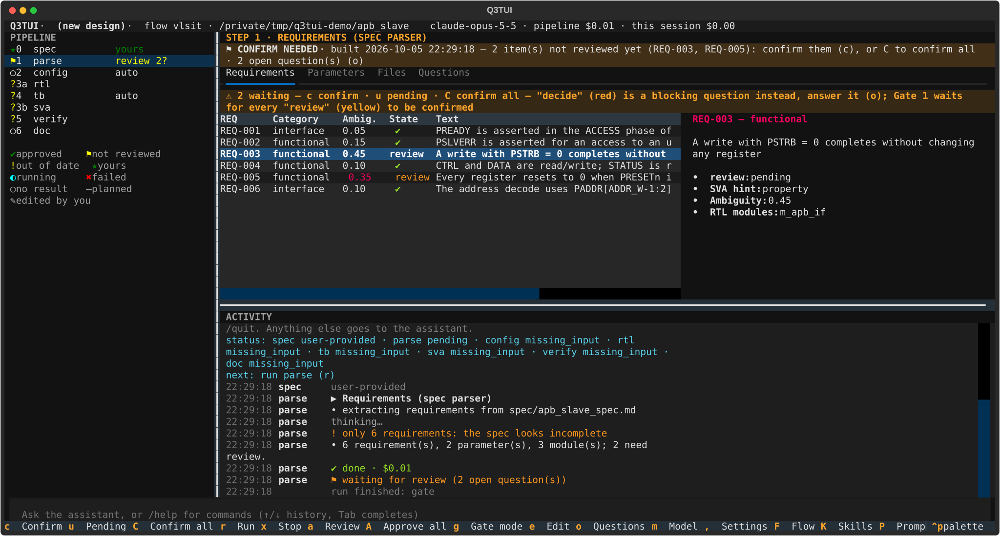

# Q3TUI

**Q3 = Quality · Quick · Quorum.** A terminal UI and CLI that takes a hardware IP block from an intent or a spec to
checked, synthesizable RTL, a testbench, and CDC / PPA results — through gated, agentic flows built on the
[Claude Agent SDK](https://code.claude.com/docs/en/agent-sdk). EDA tools (lint, synthesis, simulation, …) sit behind
pluggable, vendor-agnostic adapters.

Product of **VLSI Technology**. Status: **Beta** (0.1.0).



## What it does

You give Q3TUI a spec (or a paragraph of intent). It works through a chain of **flows**, each a pipeline of steps:

```text
spec ──► rtl ──► dv ──► sanity ──► fpga / asic
```

| Flow | Result |
|---|---|
| `spec` (default) | A reviewed spec, numbered requirements (`REQ-NNN`), parameters and the module map. |
| `rtl` | RTL checked against your coding rules, formatted, style-linted and smoke-tested; registers from a CSR generator. |
| `dv` | A testbench written from the spec alone (plain SystemVerilog, or UVM from an existing VIP), run in your simulator. |
| `sanity` | CDC / RDC analysis, every violation sorted into a waiver, an RTL fix or a question. |
| `fpga`, `asic` | PPA estimation on an FPGA part; synthesis to a standard-cell netlist with an equivalence check. |

How it behaves:

- **Gated, not a black box.** A step that needs a human decision stops at a gate; each gate's mode is `human`, `auto`,
  `auto_answer` or `none`, per project or per session.
- **Deterministic first.** Parsing, rule checks, lint, formatting, simulation and synthesis are code and tools; the model gets
  the results as facts and never has the final word on compliance.
- **Updates, not re-runs.** Change one requirement and only what it touches is updated; your approvals stay.
- **Independent verification.** The RTL never sees the testbench, and the testbench never sees the RTL (until the UVM
  backend's last integration phase).
- **One engine, three front ends.** The TUI, the CLI and the built-in chat assistant do the same things.

## Install

You need [`uv`](https://docs.astral.sh/uv/) (the installer offers to install it; it also fetches Python ≥ 3.12 when yours is
older) and access to Claude (a Claude Code login, `ANTHROPIC_API_KEY`, or a Bedrock / Vertex / gateway setup).

```bash
curl -fsSL https://raw.githubusercontent.com/nguyenquanicd/VLSIT_Q3TUI_ASIC_AI_FLOW/main/install.sh | bash
q3tui --version
```

It installs the `q3tui` command into `~/.local/bin`. Run the same line again to update.

Other ways:

- **Pin a version:** `curl … | Q3TUI_REF=<tag|branch> bash`
- **From a clone** (editable, `git pull` updates it): `./install.sh`
- **Preview or remove:** `./install.sh --dry-run`, `./install.sh --uninstall`
- **Without the script:** `uv tool install git+https://github.com/nguyenquanicd/VLSIT_Q3TUI_ASIC_AI_FLOW.git`

**EDA tools are yours to bring.** Q3TUI installs none and does not require a particular set. Each flow asks for tool *roles*
(a linter and formatter for the rtl flow, a simulator for the smoke test and the dv flow, lint / synthesis / CDC tools for the later
flows) and you give every role the command of the tool your site uses, in the project's `config/tools.json`. `q3tui tools init`
writes a **suggested reference set** to start from: use it as a reference, and adapt it or source your own tools (environment modules,
`PATH` or a setup script). It is a starting point, not a requirement. `q3tui tools check` shows what the current flow needs. A role with
no tool is reported **N/A**, never silently passed. Default model and tool modules for every project go in `~/.q3tui/q3tui.yaml`
(start from `q3tui.example.yaml`: its tool entries are examples).

## Quick start

```bash
mkdir my_block && cd my_block
q3tui init            # writes spec/intent.md: describe the block you want (or put your own spec in spec/)
q3tui                 # opens the TUI
```

In the TUI press **`r`** to run. The `spec` step drafts a spec from the intent; `parse` extracts the requirements and stops at
**Gate 1**. Press **`a`** to review (approve, answer questions, edit, or ask for changes), **`o`** for open questions, **`?`** for
every key. Then run the next flow:

```bash
q3tui --flow rtl run          # the same project, now writing and checking the RTL
q3tui status                  # steps, gates, open questions
q3tui auto                    # or: every flow of the chain, unattended
```

The repository's `examples/` (`apb_slave`: an intent for a small APB slave; `axi4_sram_ctrl`: the dv flow) are ready-made projects:
copy one, `cd` into it and run `q3tui`.

## Documentation

- **[User guide](docs/user_guide.md)** — installing, running each flow, gates and review, RTL rules, settings, every command and
  key, unattended runs, history and import, troubleshooting.
- **[Design reference](docs/spec/README.md)** — architecture and one document per flow ([spec](docs/spec/spec-flow.md),
  [rtl](docs/spec/rtl-flow.md), [dv](docs/spec/dv-flow.md), [sanity](docs/spec/sanity-flow.md), [fpga](docs/spec/fpga-flow.md),
  [asic](docs/spec/asic-flow.md)), [flows as data](docs/spec/flows.md), [configuration](docs/spec/config.md).
- **[Changelog](CHANGELOG.md)**.

## Development

```bash
uv sync
uv run pytest        # no live LLM and no EDA tools needed
```

See `CLAUDE.md` for the code layout and conventions.

## License

Apache License 2.0 — see [LICENSE](LICENSE).
