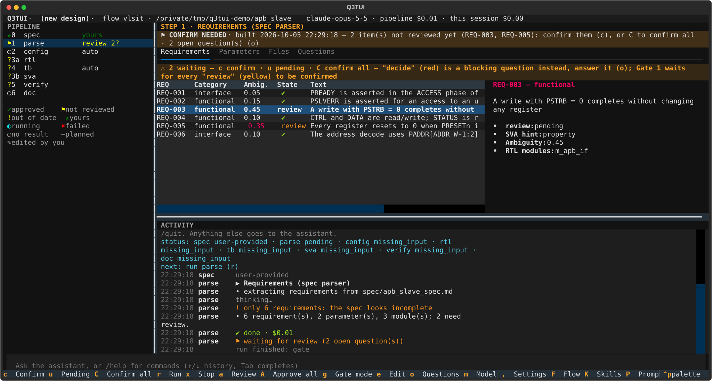
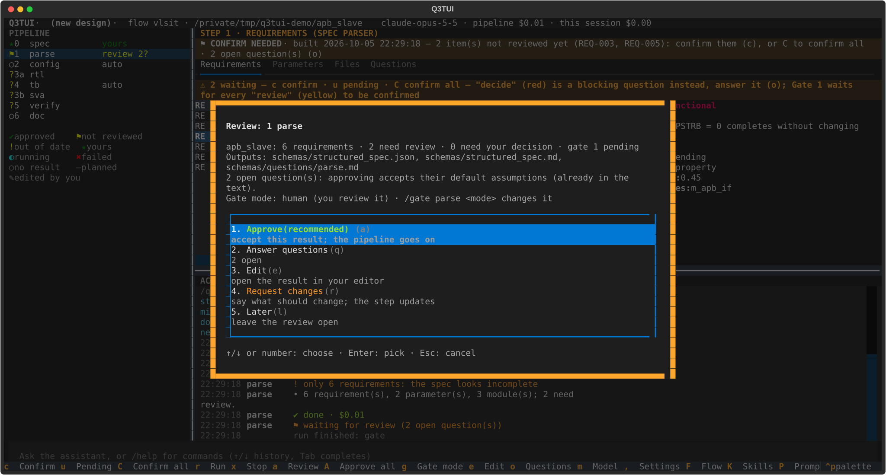

# Q3TUI User Guide

Q3TUI takes a hardware IP block from an intent (or a spec) to checked, synthesizable RTL through a chain of **flows**
(`spec → rtl → dv → sanity → fpga / asic`). Every flow is a pipeline of steps; a step that needs a human decision stops at a
**gate**, and everything that can be computed (parsing, lint, formatting, simulation, synthesis) is done by code and tools, not
by the model's word. This guide covers installing it, running a project start to finish, every flow, the rule system RTL is
checked against, every setting, and every command/key you use day to day. The design reference is [`docs/spec/`](spec/).

- [1. Install](#1-install)
- [2. Start a project](#2-start-a-project)
- [3. The flows](#3-the-flows)
- [4. Gates and review](#4-gates-and-review)
- [5. RTL coding rules](#5-rtl-coding-rules)
- [6. Settings](#6-settings)
- [7. Commands and keys](#7-commands-and-keys)
- [8. Input and output](#8-input-and-output)
- [9. The assistant (chat)](#9-the-assistant-chat)
- [10. The RTL flow](#10-the-rtl-flow)
- [11. Unattended runs and the fix loop](#11-unattended-runs-and-the-fix-loop)
- [12. History and import](#12-history-and-import)
- [13. Command-line reference](#13-command-line-reference)
- [14. Troubleshooting](#14-troubleshooting)

## 1. Install

**You need**

| | |
|---|---|
| [`uv`](https://docs.astral.sh/uv/) | The installer can install `uv` for you; `uv` fetches a newer Python when yours is older. |
| LLM access | A Claude Code login (the default), or another provider: the Claude API or an endpoint that speaks it, a ChatGPT subscription (the Codex models), the OpenAI API or an endpoint that speaks it ([Providers](#provider)). |
| EDA tools (optional, yours) | Q3TUI ships none. A linter and formatter for the rtl flow, a simulator for smoke / dv, lint, synthesis and CDC tools for the later flows: bring the ones your site uses (see below). A role with no tool configured is reported **N/A**, never silently skipped. |

```bash
curl -fsSL https://raw.githubusercontent.com/nguyenquanicd/VLSIT_Q3TUI_ASIC_AI_FLOW/main/install.sh | bash   # no clone needed
q3tui --version
```

It installs the `q3tui` command into `~/.local/bin`. Run the same line again to update. Other ways:

- **Pin a version:** `curl … | Q3TUI_REF=<tag|branch> bash`
- **From a clone** (editable, `git pull` updates it): `./install.sh`; `--no-editable` installs a copy.
- **Preview or remove:** `./install.sh --dry-run`, `./install.sh --uninstall` (your `~/.q3tui` settings and projects are untouched).
- **Without the script:** `uv tool install git+https://github.com/nguyenquanicd/VLSIT_Q3TUI_ASIC_AI_FLOW.git`.

Settings for every project go in `~/.q3tui/q3tui.yaml` (start from `q3tui.example.yaml`).

**EDA tools are yours.** Q3TUI does not install them or require a particular set: every flow runs *roles* (`lint`, `synth`, `sim`, …) and
`config/tools.json` of the project says which command each role runs. `q3tui tools init` writes a **suggested reference set** of roles:
use it as a reference, then adapt it or source your own tools. They load through environment modules (`tools.modules`, or a per-role
override), a setup script, or are on your `PATH`. `q3tui tools check` says which roles the current flow needs and whether each is
configured; [setting up the tools for your site](#setting-up-the-eda-tools-for-your-site) is below.

### Setting up the EDA tools for your site

Q3TUI never calls a vendor tool directly: every flow runs a **tool role** (`sim`, `lint`, `cdc`, `fpga_quartus_pro`, …), and a role is a
command you describe for your machine. This section shows where to put yours.
command you describe for your machine. This page shows where to put yours.

#### Start a tools file

In the project folder:

```sh
q3tui tools init      # writes config/tools.json: the roles every built-in flow uses, with plain commands (vcs, dc_shell, vc_static_shell, …)
q3tui tools check     # for the current flow: each role it needs, whether it is configured and its binary is found
```

Q3TUI reads the first tools file it finds:

1. `tools.file` of `q3tui.yaml` (a path; `$VAR` and `~` expand);
2. `<project>/config/tools.json` (or `tools.yaml`);
3. `~/.q3tui/tools.json` (or `$Q3TUI_HOME/tools.json`): **one file for every project on this machine**, used when a project has none.

`tools.roles` in `q3tui.yaml` then overrides single roles of that file.

#### Make the tools reachable

Pick what fits your site; they combine.

**On PATH already** (you load your tools in your shell): nothing to do; the default commands (`vcs …`, `vc_static_shell …`) are found on PATH.

**Environment modules**: list them in the tools file, for all roles or per role:

```json
{
  "modules": ["synopsys/vcs", "synopsys/syn"],
  "roles": {
    "fpga_quartus_pro": {"cmd": "quartus_sh -t {script}", "modules": ["quartus/pro"]}
  }
}
```

`modules_init` names the modules init script when it is not `$MODULESHOME/init/bash`.

**A setup script** your site provides: `"setup_script": "/path/to/eda_setup.sh"` (sourced before every tool).

**A given install**: put the full path in the role's `cmd` and the variables the tool needs in its `env`:

```json
{
  "roles": {
    "cdc": {
      "cmd": "/path/to/vc_static/<version>/bin/vc_static_shell -f {script}",
      "env": {"VC_STATIC_HOME": "/path/to/vc_static/<version>"}
    }
  }
}
```

Keep the placeholders (`{script}`, `{files}`, `{workdir}`, …) as the template has them: Q3TUI fills them in.

#### Standard-cell libraries (ASIC flow)

The ASIC flow finds the `.db` libraries through a catalog (`q3tui/flows/asic/pdks.json`) whose paths start at **`$PDK_ROOT`**:

```sh
export PDK_ROOT=/path/to/your/pdks     # e.g. $PDK_ROOT/GF180/…, $PDK_ROOT/FreePDK45/…
```

Your own technologies go in `<project>/config/pdks.json` (same format; an entry with the same `id` replaces the built-in one). Or give
the synthesis step its library directly: Settings (`,` on `asic_synth` → Library), or in `q3tui.yaml`:

```yaml
pipeline:
  step_options:
    asic_synth:
      library: $PDK_ROOT/GF180/…/gf180mcu_fd_sc_mcu7t5v0__tt_025C_5v00.db   # one path or a list; ~ and $VAR expand
```

#### Tools Q3TUI can find or install

| Tool | How it is found |
|---|---|
| RISC-V GCC, Spike (dv `prepare`) | the roles `riscv_gcc` / `iss` if set, else `$RISCV/bin`, PATH, then `~/.q3tui/tools/{riscv-gcc,spike,dtc}/bin` |
| APB-CSR-Generator (rtl `csr`) | `csr.tool_dir`, `env.CSR_GEN_HOME` of the `csr_gen` role, `$CSR_GEN_HOME`, `~/.q3tui/tools/APB-CSR-Generator` (`q3tui act csr_tool_install` clones it) |
| Verible (rtl `format`, `style_lint`) | `verible-verilog-format` / `verible-verilog-lint` on PATH, or the full path in the roles `verible_format` / `verible_lint` |

#### Check it

```sh
q3tui tools check        # ✔ role: binary found · ✖ role: not configured / not found
```

A role that fails at run time (crashed, timed out, not found) stops the step as a **tool failure**, not a design failure: the TUI's
assistant (and an unattended run) is told the error, the role and the machine's memory, and can fix the role's `timeout_s`, `env` or
`modules` itself; what it cannot fix (an install) it tells you.

## 2. Start a project

A project is any directory with a `spec/` folder (or a `q3tui.yaml`). Q3TUI writes its deliverables under
that directory and keeps its own state in `.q3tui/` (never read by the LLM).

```bash
mkdir my_block && cd my_block
q3tui init                                  # spec/intent.md skeleton (or: mkdir spec && vi spec/my_block_spec.md)
q3tui                                       # opens the TUI: r runs, a reviews, o answers questions
```

To try it on something that exists, copy `examples/apb_slave` (an intent only, for the spec flow) or use
`examples/axi4_sram_ctrl` (the dv flow), and run `q3tui` in the copy. `q3tui status` shows every step, its review gate and open
questions without opening the TUI; `q3tui run` is the same as `r`.

**Starting point — a spec, or just an intent:**
- **A spec file** in `spec/` (Markdown, or a PDF) — `parse` reads it as-is.
- **An intent only** (`spec/intent.md`, a short paragraph of what you want built) — the `spec` step drafts a
  full spec from it section by section, asks what's left open, and only then hands off to `parse`.

### The screen



| Area | What it shows |
|---|---|
| **Pipeline** (left) | Every step: status icon (legend below it), number (`1`–`9` jump to it), gate mode or what it is waiting for (`review 2?`). |
| **Step view** (top right) | The selected step's result, in tabs (Requirements / Parameters / Files / Questions / …). A banner on top says what the step needs from you. |
| **Activity** (bottom right) | The live log of the run, and the assistant's replies. `z` zooms it. |
| **Command / chat bar** | `/command` (Tab completes, ↑/↓ history), or plain text to the assistant (`i` focuses it). |
| **Footer** | The keys of whatever has focus; `?` lists them all. |

Drag the dividers (or `ctrl+arrows`) to resize; sizes are kept per project.

## 3. The flows

`pipeline.flow` (in `q3tui.yaml`, or `q3tui --flow <name> …` for one command) picks the flow; `q3tui flow list` shows them all.
The default is `spec`. All flows work in one project folder and hand work to each other as change requests.

| Flow | Steps | What you get | Reference |
|---|---|---|---|
| `spec` (default) | spec → parse → config | A reviewed spec, the requirements (`REQ-NNN`), the parameters and the module map. | [spec-flow.md](spec/spec-flow.md) |
| `rtl` | the three above → rules → csr → rtl → format → style_lint → smoke | Checked RTL in `src/rtl/` (see [§10](#10-the-rtl-flow)). | [rtl-flow.md](spec/rtl-flow.md) |
| `dv` | the three above → testplan → tb → prepare → simulate | A testbench written from the spec alone (plain SystemVerilog, or UVM from an existing VIP with the RTL as the DUT), the test programs, and simulation results read from the logs. | [dv-flow.md](spec/dv-flow.md) |
| `sanity` | sdc → setup → CDC / RDC analysis → waiver review → check | Static CDC / RDC results with every violation sorted into a waiver, an RTL fix, a spec question or a question for you. | [sanity-flow.md](spec/sanity-flow.md) |
| `fpga` | port → SDC → synthesis → timing / utilization report → PPA fixes | Area / timing estimates on an FPGA part. | [fpga-flow.md](spec/fpga-flow.md) |
| `asic` | port → SDC → Design Compiler → logic equivalence check | A standard-cell netlist proved equal to the RTL. | [asic-flow.md](spec/asic-flow.md) |
| `project` | — | The project, its tools, its standard-cell libraries and its FPGA (settings only). | [project-flow.md](spec/project-flow.md) |

You can write your own flow (a folder, a file or markdown; copy `q3tui/flows/example/`): [flows.md](spec/flows.md).

### The spec flow

```text
spec ─► parse ─► config
 human   Gate 1   Gate 2
         human    auto
```

| Step | What it does | Gate |
|---|---|---|
| **spec** | Drafts (or accepts your) IP specification. | human |
| **parse** | Extracts requirements (REQ-IDs), parameters, module map from the spec; flags ambiguity. | **1 · human** |
| **config** | Resolves parameter values against your change requests; checks elaboration constraints. | 2 · auto (self-signs when constraints pass) |

### The other flows in one paragraph each

- **`rtl`** reuses the three spec steps, then writes and checks the RTL ([§10](#10-the-rtl-flow)).
- **`dv`** reuses them too, then `testplan` (the verification contract and the tests, with the open issues you answer), `tb` (the
  testbench, built from the spec, the requirements and the configuration — never from the RTL, except the UVM backend's last phase,
  where the RTL is integrated as the DUT), `prepare` (the programs and data the plain testbench's tests load) and `simulate`
  (the tests run, every status read from the simulator log). The testbench kind is the `tb` step's `testbench` option: `plain`,
  `uvm` (needs a VIP) or `auto`. Reports are in `reports/`; example: `examples/axi4_sram_ctrl`. Testbench files cannot be imported yet.
- **`sanity`** takes the RTL (read only) and the SDC, and runs CDC / RDC analysis with Synopsys VC Static. One LLM stage decides the
  analysis environment (resets, black boxes, constants) and, later, reviews the violations; code runs the tool and checks the result.
  A missing tool fails the step ("not run"); it never passes.
- **`fpga`** / **`asic`** take the RTL (read only) and estimate or synthesize it. The two share `constraints/sdc/`; a fix that
  would change the RTL goes back to the rtl flow as a change request.

**Updates, not re-runs:** editing a requirement, a parameter, or asking for a change re-runs only what that
change actually affects — earlier steps and your existing approvals are untouched unless the change reaches
them.

## 4. Gates and review

A gate is a stop for your decision. Every gate has a **mode**:

| Mode | Behavior |
|---|---|
| `human` | Always stops; only you can approve (`a` / `/approve`). |
| `auto` | Approves itself once there are no *blocking* questions — unconfirmed review items (below) don't count against it. |
| `auto_answer` | Unattended: approves itself, answers every question (blocking too) with its default. |
| `none` | No gate at all. |

Change a gate's mode: `g` (picker) or `/gate <step> <mode>`. `pipeline.auto_approve` / `pipeline.auto_answer`
(settings, or `/autoapprove` `/autoanswer`) override every gate's mode at once.

**Two things a gate can be waiting on**, shown right on the step's result banner:

- **A blocking question** — an actual decision only you can make (an ambiguous requirement, a parameter
  conflict, …). Open the Questions tab (`o`) and answer it.
- **Unconfirmed review items** — flagged requirements, or parameters changed from default
  that nobody has looked at yet. These never block an `auto`/`auto_answer` gate (it signs itself, and the
  items simply stay open), but they **do** block a plain `Approve` (`a`) on a `human` gate,
  unless you turn on `pipeline.auto_confirm_reviews`.



`a` opens the review dialog above: approve, answer the open questions, edit the result, request changes, or
leave it for later.

**Reviewing and confirming** (per step, in its own panel tab):

Uppercase key = **Shift+that letter**, a separate key from its lowercase version (e.g. `C` is not `c`).

| Step / tab | Key | Action |
|---|---|---|
| parse → Requirements | `c` | Confirm the highlighted flagged requirement as read |
| | `u` | Take it back to pending |
| | `C` (Shift+c) | Confirm every flagged requirement |
| config → Parameters | `c` / `u` / `C` (Shift+c) | Same, for parameters changed from default |


`/approve <step> --force` and `/approve all` bypass blocking questions *and* unconfirmed reviews the same
way `--force` always has — use it when you've judged it fine, not as a habit.

## 5. RTL coding rules

Every RTL stage reads a **rule file** (plain Markdown, the same text an engineer would read) and a
**deterministic checker** verifies what's objectively checkable against it — naming patterns, prohibited
constructs, name length, file/module-name match, and more. The LLM is told the rules; it does not get to
decide whether it followed them.

- **Default baseline:** `q3tui/flows/rtl/rtl/rules/rtl_rule_default.md` — ASIC synthesis
  rules (naming, DFT port conventions, prohibited constructs P1–P29, a tapeout-readiness checklist).
- **Add your own:** drop a rule file (e.g. `my_rules.md`) in your project root and list it alongside the
  default in `pipeline.step_options.rtl.rules` in `q3tui.yaml`:
  ```yaml
  pipeline:
    step_options:
      rtl:
        rules: [rtl_rule_default.md, my_rules.md]
  ```
  A project file with the *same name* as the shipped default overrides it outright (checked first).
- **What's enforced in code today:** naming prefixes (`i_`/`o_`/`reg_`/`w_`/module/instance/parameter
  patterns), name length (30 chars, default profile), prohibited testbench-only system tasks (`$display`,
  `$finish`, `$random`, …) — `$error` is allowed only as the sanctioned elaboration-time parameter-validation
  exception — `casex`, `defparam`, `inout` outside a pad wrapper, signed types/literals, two-state types,
  `` `define ``/`` `undef ``, and more. Anything not mechanically checkable (e.g. the abbreviation table,
  combinational-loop freedom) stays guidance the LLM follows from the rule text.

## 6. Settings

Open with `,` (Settings dialog) or `/settings [tab]`; every setting is also readable/settable by the
assistant (`get_settings` / `set_settings`). Add `--save` to a `/command` form, or leave "Only for this
session" unticked in the dialog, to persist a change to `q3tui.yaml`; leave it ticked (or omit `--save`) to
try something for this session only.

The dialog has one tab per area: **General**, **Gates**, **LLM**, **Provider**, **Models per step**, **Spec**, **RTL**.

### General

| Setting | Type | What it does |
|---|---|---|
| `pipeline.auto_approve` | bool | Every gate approves itself; a gate with blocking questions still stops and asks. |
| `pipeline.auto_answer` | bool | Unattended: every gate approves itself, every question (blocking too) takes its default, and proposals are accepted as suggested. |
| `pipeline.max_fix_iterations` | int | How many times a step's check → fixes → check loop may repeat before stopping and handing it to you. |
| `pipeline.escalate_after_repeats` | int | A bug classified the same way this many times in a row is handed to you instead of being fixed again automatically. |
| `pipeline.auto_confirm_reviews` | bool | Confirms a step's own reviewable items (flagged requirements, changed parameters) without asking. A human gate still stops for `Approve`; `Approve` itself no longer refuses for unconfirmed items. Narrower than auto-approve/auto-answer above — gates still stop, only per-item review is skipped. |
| `tui.icons` | choice | Status icon set: `unicode` (✔ ⚑ ◐ …), `nerd` (needs a "… Nerd Font Mono" font), `ascii` (any font). |
| `tui.language` | choice | TUI chrome (legend, result banners, dialogs) and pipeline-generated content (spec, RTL comments, questions, docs): `en` / `vi` / `ko`. The assistant chat is unaffected — it always mirrors whichever language you write to it in. |

### Gates

One mode selector per step with a review gate: **human** (stops for you) / **auto** (approves itself;
blocking questions still stop it) / **auto-answer** (unattended) / **none** (no gate at all). Same as
pressing `g` on a step, or `/gate <step> <mode>` — this tab just shows every step's mode together. See
[§4](#4-gates-and-review) for what each mode actually does.

### LLM

| Setting | Type | What it does |
|---|---|---|
| `llm.model` | choice | Default model for every stage from the next stage on: Sonnet 5.5 (default), Opus 5.5 (best quality), Haiku 4.5 (cheapest, no effort setting), Fable 5.1 (most capable, most expensive). |
| `llm.effort` | choice, nullable | How hard the model thinks: `low` / `medium` / `high` / `xhigh` / `max`. Empty for Haiku 4.5 (it has no effort setting). |
| `llm.thinking_budget` | int, nullable | Only for models without an effort setting (Haiku 4.5): caps thinking tokens. `0` = off, empty = model default. |
| `llm.max_budget_usd` | float, nullable | Stop a stage that costs more than this (empty = no limit). |
| `llm.tool_output_limit` | int | What one tool call may return; results are re-sent every later turn, so long ones are cut (head + tail kept). |
| `llm.stage_token_budget` | int, nullable | Warn when one stage reads more input tokens than this (cache included; empty = never warn). |
| `llm.timeout_s` | int, nullable | Wall-clock limit per LLM stage (empty = none, same as Claude Code). |
| `llm.fallback_model` | text, nullable | Used when the primary model is overloaded (empty = none). |

### Provider

Where the LLM stages' requests go (Settings → **Provider**, or `llm.provider` in `q3tui.yaml`):

| Provider | What you need |
|---|---|
| **Claude subscription** (default) | Your Claude Code login. Nothing to set. |
| **Claude API compatible** | A Claude API key (`ANTHROPIC_API_KEY`). **API base**: empty for the Claude API, or the URL of an endpoint that speaks it. |
| **OpenAI subscription** | A ChatGPT login: **Log in to ChatGPT** in the Provider tab (or `q3tui gateway login`), open the link it shows and enter the code. Models: `gpt-5.5`, `gpt-5.3-codex`, … |
| **OpenAI API compatible** | An OpenAI API key (`OPENAI_API_KEY`). **API base**: empty for the OpenAI API, or the URL of any endpoint that speaks it (vLLM, Ollama, a company gateway). |

- **Keys** go to `~/.q3tui/keys.env` (only you can read it), never to the project's `q3tui.yaml`. Type one in the
  Provider tab (it shows only whether a key is set) or run `q3tui keys set OPENAI_API_KEY`.
- The two **OpenAI** providers run through a small local gateway (LiteLLM) that Q3TUI starts by itself when a stage
  needs it. The installer sets it up (`q3tui gateway install`: once, a few minutes); a start then takes about half a
  minute (LiteLLM loads slowly). `q3tui gateway status` shows the provider, the gateway, the login and the keys;
  `q3tui gateway stop` stops it.
- Switching the provider also switches the model when the new provider does not have it. Any model name the provider
  knows works: pick one in the LLM tab, type it in the model dialog (`m`), or set `llm.model`.
- Other providers' models take no effort setting, and their cost may show as $0 (Claude Code prices only Claude models).
  How well they follow the flows' tool use and structured answers varies by model.

### Models per step

One `model` + `effort` pair per step (one per LLM step of the current flow) and for the assistant —
leave unset to use the LLM tab's default. Lets you mix models,
e.g. Opus where precision matters, Haiku for mechanical/high-volume work.

### Spec

| Setting | Type | What it does |
|---|---|---|
| `spec.self_review` | bool | A second pass that checks the draft for ambiguities and returns only its changes. Off = faster drafts, no ambiguity check. |

### RTL

| Setting | Type | What it does |
|---|---|---|
| `rtl.parallel` | int | Modules written at once. |
| `rtl.max_fix_attempts` | int | Extra rounds when lint or synthesis still fail. |
| `rtl.max_turns` | int | Agent turns for one module (write, compile, fix). |

The coding rules are the rtl flow's own rule files, see [§5](#5-rtl-coding-rules).

## 7. Commands and keys

Press `/` to type a command (Tab/→ completes); the same actions are keys when a step view has focus. A
single-letter key shown **uppercase** means **Shift+that letter** — it is a different key from its lowercase
version, and in this flow the two are never the same action.

| Action | Key | Command |
|---|---|---|
| Run the pipeline (optional range) | `r` | `/run [from] [to]` |
| Stop the running step / the assistant's reply | `x` | `/stop` |
| Open the review gate dialog | `a` | — |
| Approve a gate, or every gate waiting | `A` (Shift+a) | `/approve <step>|all [--force]` |
| Queue a change request for a step | — | `/change <step> <text>` |
| Answer a question | — | `/answer <id> <text>` / `/answer all` |
| Open Questions tab | `o` | — |
| Set a gate's mode | `g` | `/gate <step> <mode> [--session]` |
| List every gate | — | `/gates` |
| Flow editor | `F` (Shift+f) | `/flow` |
| Skill editor | `K` (Shift+k) | `/skill` |
| Prompt editor | `P` (Shift+p) | `/prompts` |
| Customise a step (view/pass/notes) | — | `/step <step> view|pass|notes [text]` |
| Reset a step's outputs (or everything) | `R` (Shift+r) | `/reset <step>|all [--only]` |
| Edit the current file | `e` | — |
| Comment on selected text / a highlighted row | `C`\* (Shift+c) | — |
| Switch model / reasoning effort | `m` | `/model [id]` / `/effort <level>` |
| Toggle self-review / auto-approve / auto-answer / auto-confirm | — | `/specreview` `/autoapprove` `/autoanswer` `/autoconfirm on|off` |
| Settings dialog | `,` (comma) | `/settings [tab]` |
| Usage statistics | `s` | `/stats [reset]` |
| LLM cost so far | — | `/cost [reset]` |
| Select step 1–9 | `1`–`9` | — |
| Resize panes | ctrl+arrows, or drag | — |
| Zoom the chat/activity pane | `z` | — |
| Focus the chat input | `i` | — |
| Start a fresh assistant conversation | — | `/newchat` |
| Quit | ctrl+q | `/quit` |
| Help | `?` (shift+/) | `/help` |

\* `C` (Shift+c) is **Comment** app-wide, but **Confirm all** when a Requirements/Parameters tab
has focus — see [§4](#4-gates-and-review). The step-specific review keys (`c`/`u`/`C` to confirm) are listed in that table, not repeated here.

## 8. Input and output

```text
spec/<ip>_spec.md                       your input (or the spec step's own output, from an intent)
schemas/structured_spec.json            parse    — Gate 1
schemas/final_config.json               config   — Gate 2
schemas/synth_report.json               rtl
reviews/{parse,config}_reviews.json     your per-item reviews (kept across a reset)
src/rtl/*.sv, filelist.f                    rtl (rtl flow)
config/{tools,pdks}.json, rtl_rules.md   your configuration
constraints/sdc/                        the SDC (fpga / asic / sanity flows)
reports/  build/                        readable results / disposable tool output
.q3tui/…                                internal only — never read by an LLM stage
```

## 9. The assistant (chat)

Type anything that isn't a `/command` into the bottom input and it goes to the assistant — it has a tool for
every action in this guide (run a step, answer a question, change a gate mode, review a requirement, change settings, …) and asks for confirmation before anything destructive (reset, turning on
unattended modes). It always replies in whatever language you write to it in, independent of `tui.language`.

## 10. The RTL flow

`pipeline.flow: rtl` (in `q3tui.yaml`, or `q3tui --flow rtl`) runs RTL generation on its own, checks it and smoke-tests it; verification is left to another flow.
Design reference: `docs/spec/rtl-flow.md`.

```
spec → parse → config → rules → csr → rtl → format → style_lint → smoke
```

1. **Your rules.** `q3tui act rtl_rules_init` writes `config/rtl_rules.md`: one rule per bullet, `- **ID** text`. They are read before Q3TUI's default rules (same id =
   override). The `rules` step checks them for contradictions (it stops with the exact text to change) and writes the Verible flags to `src/rtl/style_lint/`.
2. **Registers.** If the spec has a register map, the `csr` step drafts `src/rtl/csr/csr_map.json` and generates the register block with the APB-CSR-Generator
   (`q3tui act csr_tool_install` once; or set `csr.tool_dir`, `env.CSR_GEN_HOME` of the `csr_gen` role in `config/tools.json`, or `$CSR_GEN_HOME`). Edit `csr_map.json` to change a register: it is yours after the first draft. `csr.mode: off` skips it.
3. **RTL, format, style lint.** `rtl` follows the rules; `format` only changes whitespace (it asks before touching a file you edited); `style_lint` runs Verible and sends
   violations back to `rtl`. This repeats by itself, up to `style_lint.max_rounds`.
4. **Smoke test.** A small testbench written from the spec only, compiled and run (tool roles `sim` and `run`). A failure is triaged and fixed, or becomes a question for you.

Tools: every role (`verible_lint`, `verible_format`, `csr_gen`, `sim` / `run` / `lint` / `synth`, …) comes from your `config/tools.json`; the flow has no defaults and there is no
fallback. Start from the suggested reference set of `q3tui tools init` and adapt it. A missing tool makes its step wait and name the role. **Skills:** the LLM stages read playbooks (`config/skills/<name>/SKILL.md`); put your own in
`<project>/config/skills/` to add or replace one. `q3tui act style_show` and `q3tui act csr_show` print what the flow decided.

## 11. Unattended runs and the fix loop

**Full run.** `q3tui auto` (TUI `/auto`, `/auto stop`) runs every flow of `pipeline.chain` (default `spec, rtl, dv, sanity, fpga`) in
order, with no gate stopping for you, until each flow passed with the RTL as it is at the end. A flow that changes the RTL (a
Sanity fix, an fpga PPA fix) makes the checking flows that passed before it run again, at most `pipeline.chain_max_runs` times
(default 3); a flow that does not pass stops the run for you to look at. `q3tui auto --flows spec,rtl` runs only those flows.
Gates are approved and every question takes its default, so read the summary table, `q3tui status` and the reports afterwards.

**Fix loop for CDC / RDC.** `q3tui --flow sanity loop [--owner rtl] [--max-rounds N] [--max-cost USD]` runs the Sanity analysis, hands the review's fixes to the rtl flow, lets it
update the RTL and analyses again, until nothing is open, a round is not better than the best one, nothing can be handed off, a flow fails or the spend limit is reached. The best round's
RTL is kept; `q3tui loop --restore-best` puts it back. `q3tui act sanity_handoff` also adds the review's plain SDC commands to `constraints/sdc/extra.tcl` (when the SDC comes from `sdc.json`).

## 12. History and import

**History.** Q3TUI keeps its own record of the project in `.q3tui/history/`: a version each time a step finishes and each time a flow
passes (`passed/<flow>`). It is separate from your git (never pushed, never touches your `.git`). `q3tui history [log]`,
`q3tui history diff VERSION [TO]`, `q3tui history show VERSION PATH`, `q3tui history restore VERSION [PATHS…]`; in the TUI `H` or
`/history`. A restore asks first and backs up what it replaces; steps that read the restored files are out of date afterwards.
Off with `pipeline.history: false`. Details: [history.md](spec/history.md).

**Import.** `q3tui import PATH [--kind all|spec|rtl|tb|sva]` copies your own files into the project: spec documents go to `spec/ref/`
(the spec step ports them into its template), RTL is mapped and checked against the rules, not rewritten. Testbench and SVA files
are recognised only to keep them out of the RTL; they are not taken yet. Nothing runs: `q3tui run` next. Details:
[spec-flow.md](spec/spec-flow.md) "Importing".

## 13. Command-line reference

`q3tui` with no command opens the TUI. Global options: `-C/--project DIR`, `--config FILE`, `-m/--model ID`, `--effort LEVEL`,
`--flow NAME|FILE`. `q3tui COMMAND --help` has the full text.

| Command | Does |
|---|---|
| `init [--template]` | Start a project here: `spec/intent.md` skeleton. |
| `run [from] [to]` | Run every pending or stale step, stopping at review gates. |
| `status` / `questions` | Step states, gates and open questions. |
| `answer`, `approve`, `change`, `gate` | The same actions as in the TUI ([§7](#7-commands-and-keys)). |
| `reset STEP` | Clear a step's generated outputs (shows the plan, backs up first). |
| `flow list` / `flow check` | The available flows / check one. |
| `auto` | Full unattended run of the flow chain ([§11](#11-unattended-runs-and-the-fix-loop)). |
| `loop` | CDC / RDC fix loop, with `--flow sanity`. |
| `import PATH` | Import your own spec / RTL files. |
| `history …` | The project's versions. |
| `gateway status` / `start` / `stop` / `login` / `install` | The LLM provider, the local gateway of the OpenAI providers, the ChatGPT login ([Provider](#provider)). |
| `keys list` / `set NAME` / `clear NAME` | The providers' API keys, in `~/.q3tui/keys.env`. |
| `tools init` / `tools check` | Write `config/tools.json` from a preset / check which tool roles are configured. |
| `act [NAME key=value …]` | The flow's add-on actions (`q3tui act` lists them), e.g. `rtl_rules_init`, `csr_tool_install`. |
| `design parse` / `design check` | Parse and compile-check a design, no LLM. |
| `config show` | The effective configuration. |
| `cost` / `stats` | LLM cost and token statistics. |
| `tui` | Open the TUI (read-only watcher while another run is going). |

Settings come from `./q3tui.yaml` over `~/.q3tui/q3tui.yaml` ([§6](#6-settings), schema in [config.md](spec/config.md)).

## 14. Troubleshooting

| Symptom | What to do |
|---|---|
| A step says a tool role is **N/A** or waits "for role X" | `q3tui tools check`, then `q3tui tools init` or edit `config/tools.json` (and `tools.modules`). The step never passes without the tool. |
| LLM stage fails to start / authentication error | `q3tui gateway status`: the provider and what it still needs. Claude subscription: log in with Claude Code. Others: the key (`q3tui keys set …`) or the ChatGPT login (`q3tui gateway login`); the gateway's log is `~/.q3tui/gateway/gateway.log`. |
| A second run does not start, or waits | One run per flow per project folder (`.q3tui/run.<flow>.lock`); a step another run is executing is waited for. Use the TUI as a watcher meanwhile. |
| A gate will not approve | Open the Questions tab (`o`) and unconfirmed review items ([§4](#4-gates-and-review)); `/approve --force` only when you have judged it fine. |
| A step re-ran something you did not expect | Everything is content-hashed: check what changed (`q3tui history diff`). `format` asks before touching a file you edited. |
| Cost is higher than expected | `q3tui cost`, `q3tui stats`; use a cheaper model per step, `llm.max_budget_usd`, or `llm.effort: low`. |
| Wrong state, want to start a step over | `q3tui reset STEP` (your hand-written files and `reviews/` are kept). |

### Known limitations (beta)

- **rtl flow:** the known issues KI-1 … KI-9 are listed in [rtl-flow.md](spec/rtl-flow.md) "Known issues".
- **Languages:** `tui.language` translates the legend, result banners and the Questions / Picker dialogs; the keybinding help and some
  dialogs (Settings, Flow / Skill / Prompt editors, Stats) are English only. Key labels and table headers of a widget are set when it
  first mounts: after switching the language, reopen the tab or dialog (or restart the TUI).
- **RTL rule checking by code** covers naming, length and the prohibited-construct list; a few rules (the abbreviation table,
  combinational-loop freedom) are guidance the LLM follows and are not independently verified.
- **Import:** testbench and SVA files are not taken yet ([§12](#12-history-and-import)); SVA, the mutation / traceability verification
  and the generated specification document of the former VLSIT flow were removed.
